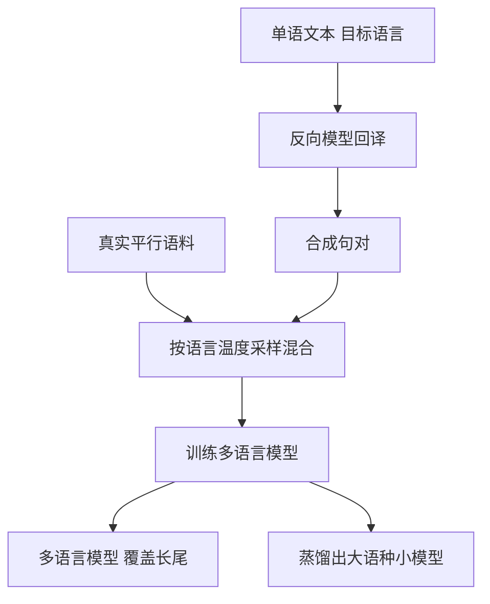

## Q
**深挖 · 多语言模型与低资源语言**｜机器翻译服务

面试官：「100 多种语言就是上万个语言对。你训练一个模型还是很多个？只有几万句平行语料的小语种怎么办？用专门的翻译模型还是大语言模型？」

## A
**一句话。** 用一个多语言模型覆盖所有语言对：在输入前加"翻成某语言"的标记，所有语言共享一套参数，小语种借大语种学到的结构；低资源语言用回译扩充数据；流量最大的几个语言对另外部署专用的小模型或蒸馏模型以降低成本；大语言模型用于质量要求高、量不大的场景。

**步骤。**
1. **目标语言标记：** 训练和推理时在源句前加如 `<2ja>` 的标记，模型据此决定输出语言。没有直接平行语料的语言对（如斯瓦希里语到泰语）也能翻，称为零样本翻译，质量一般低于有数据的方向。
2. **采样平衡：** 大语种数据多出几个数量级，按原比例训练会让小语种几乎学不到。做法是"温度采样"：把各语言的采样比例拉平一些，让小语种被多看几遍。
3. **回译：** 用"目标→源"的模型把目标语言的大量单语文本翻成源语言，得到"机器写的源句 + 人写的目标句"；目标端是真实文本，所以模型学到的输出是地道的。
4. **词表：** 所有语言共用一个子词词表（把词切成常见片段，如 "un + believ + able"），词表要足够大，否则小语种的词被切得很碎、句子变长、质量和速度都差。
5. **分层部署：** 前几十个语言对占大部分流量，用知识蒸馏（让小模型学大模型的输出）得到专用小模型；长尾语言对走大的多语言模型。

**故障与处理。**
- **多语言诅咒：** 语言越多、每种语言分到的模型容量越少，大语种质量反而下降。处理：增大模型，或大语种用专用模型。
- **翻错目标语言：** 零样本方向偶尔输出成英语。处理：输出端做语言识别，错了就换路径（先翻成英语再翻成目标语言）。
- **回译噪声：** 反向模型太差时合成数据有害。处理：给合成数据加标记，控制占比，按开发集效果调。

**为什么这样，不那样。**
- **不为每个语言对训一个模型：** 上万个模型无法维护，小语种也没有足够数据单独训练。
- **专用翻译模型对比大语言模型：** 专用模型小、快、便宜，延迟稳定；大语言模型对俚语、上下文和风格更好，可以直接在提示里给术语表，但每句成本高几倍到几十倍，还可能多说话（加解释、不翻完）。

**数字。** 每多一个语言对，人工评测成本就多一份，所以人工评测只覆盖流量最大的语言对和抽样的长尾。
