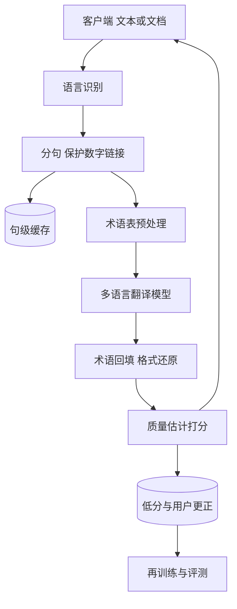

## Q
**全景**｜完整答案 · 机器翻译服务

面试官：「设计一个机器翻译服务：支持 100 多种语言，既翻译用户输入的短句，也翻译整篇文档和网页；企业客户要求专有术语按他们的词表翻。按 ML 系统设计的七步讲。」

## A
**一句话。** 核心是序列到序列模型（输入一种语言的句子、输出另一种语言的句子）：一个多语言模型覆盖全部语言对，靠"目标语言标记"指定翻成什么；服务层负责语言识别、分句、缓存、术语约束和长文档的异步处理；评估以自动指标做回归、人工评分做最终裁决。

**① 需求。**
- **功能：** 自动识别源语言；短句实时翻译；文档保留格式；企业术语表；用户可提交更正。
- **非功能：** 短句 P95 < 500 ms；文档异步、按页数给预计时间；专有名词、数字、链接不能被改坏。
- **规模（假设）：** 每天 10 亿个句子，平均约 12,000 句/秒，峰值约 3 万句/秒；其中约 80% 集中在几十个大语种对。

**② 定义成 ML 任务。** 条件生成：输入源句和目标语言，输出目标句。损失是交叉熵（衡量模型给正确译文每个词的概率有多低），也就是逐词预测参考译文。

**③ 数据。** 平行语料（同一句话的两种语言版本），来自公开语料、多语网站的对齐挖掘；低资源语言靠回译（用反方向模型把目标语言单语文本翻回源语言，造出合成的句对）。清洗：语言识别过滤、长度比异常过滤、去重。

**④ 模型。** 编码器—解码器 Transformer（编码器先把整句源文读成一组向量，解码器逐词生成译文，每步回看编码器的结果）。大语种对也可以用大语言模型提示翻译，质量好但更贵。

**⑤ 评估。** 离线：BLEU、chrF（按字符片段重合打分）、COMET（训练来模仿人工评分的模型指标）；人工：专业译员按错误类型和严重度打分。在线：用户修改率、"复制译文"率、反馈。

**⑥ 部署。** 按语言对分组批处理；句级缓存（热门句子和网页模板命中率高）；文档走异步队列，分句并行翻译后按原格式回填。

**⑦ 监控。** 每个语言对的延迟、错误率、缓存命中率；源语言识别失败率；自动质量估计分数（无参考译文时，用模型预测这句翻得好不好）的分布漂移。

**必讲深挖。**
- **多语言建模：** 一个模型还是每个语言对一个、低资源语言、编码器—解码器还是大语言模型。
- **评估与术语：** BLEU 的原理与盲点、人工评分、术语表怎么强制生效。

**级别。** 中级讲清模型和 BLEU；高级讲清多语言取舍、回译和术语；Staff 还讲成本按语言对分层（大语种用专用小模型、长尾用多语模型）和质量估计驱动的人工后编辑。
