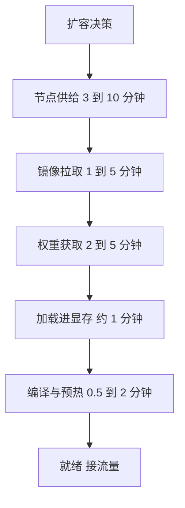

## Q
**深挖：冷启动拆解与优化**｜完整答案 · GPU 集群扩缩容与冷启动

面试官：「现在一个 70B 副本从扩容决策到能接流量要 15 分钟。拆开说时间都花在哪，每一段怎么压缩？目标是 2 分钟以内。」

## A
**一句话。** 冷启动 = 节点供给 + 镜像拉取 + 权重获取 + 加载进显存 + 预热。逐段对症：用热备节点省掉供给，镜像预拉省掉拉取，权重放节点本地 NVMe 或并行流式读取，引擎的编译与 CUDA 图结果缓存起来；最快的是让引擎"睡眠"而不是销毁。

**逐段数字与手段（70B，16 位权重约 140 GB；数量级供参考，以实测为准）。**
1. **节点供给（3–10 分钟）：** 云上新开一台 8 卡 GPU 机器要启动、加入集群、装好驱动。手段：保留少量热备节点（已加入集群、空着）；用 Karpenter 之类的节点供给器配合预先创建好的、带驱动的机器镜像；GPU 紧缺时，按需实例可能根本申请不到，所以关键容量要用预留实例。
2. **镜像拉取（1–5 分钟）：** 带 CUDA 和引擎的镜像常有 10–20 GB。手段：用 DaemonSet 在每个 GPU 节点上预拉镜像；或用按需加载的懒加载镜像（如 SOCI、stargz），先启动、用到哪块再拉哪块。
3. **权重获取（2–5 分钟）：** 140 GB 从对象存储按 1 GB/s 下载要约 2.5 分钟。手段：节点本地 NVMe 缓存（每个节点保留常用模型的权重，第二次启动直接读本地盘，几 GB/s）；或者用并行流式读取（vLLM 的 `--load-format runai_streamer` 边从对象存储并发读取，边写进 GPU），不先落盘。
4. **加载进显存（约 1 分钟）：** 从内存经 PCIe 拷进 4 张卡。使用 safetensors 格式（可以直接内存映射，不需要反序列化）。
5. **编译与预热（0.5–2 分钟）：** 引擎会编译计算图、捕获 CUDA 图（把一串 GPU 操作录下来，之后一次性重放，省掉每步的启动开销），并分配 KV 缓存。手段：缓存编译结果到共享存储，下次复用。

**更快的办法：不冷启动。**
- **睡眠模式：** vLLM 开启 `--enable-sleep-mode` 后，可以让引擎"睡眠"：一级睡眠把权重卸到 CPU 内存、丢掉 KV 缓存，空出显存给别的模型；唤醒时只需把权重从内存拷回显存，几秒到几十秒。适合多个模型轮流共享同一批卡。
- **热备副本：** 加载好但不接流量的副本，扩容等于"放进路由池"，几秒生效，代价是一直占卡。

**故障与处理。**
- **雷群下载：** 30 个新副本同时从对象存储拉 140 GB，打满带宽，每个都变慢。分批扩容，或先让一个节点下载、其他节点从同机房的缓存拉。
- **启动失败循环：** 权重文件损坏或显存不够，Pod 反复崩溃重启，扩容永远完成不了。启动时校验哈希；对"启动失败"单独报警。
- **探针误杀：** 启动探针给的时间不够，加载到一半被 Kubernetes 重启。启动探针的总时限要大于最慢启动时间。

**为什么这样，不那样。**
- **不只靠更快的扩容：** 节点供给受云厂商库存限制，不可控；必须结合热备和准入控制。
- **不把权重打进镜像：** 140 GB 的镜像推拉都极慢，且换模型就要重建镜像；权重和镜像分开存、分开缓存。
