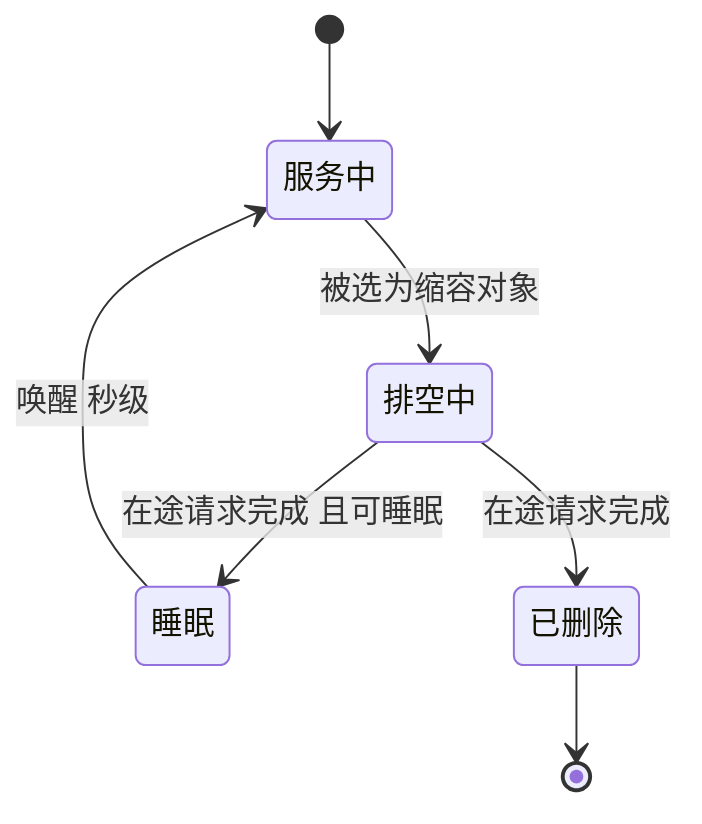

## Q
**深挖：保底副本、余量与缩容**｜完整答案 · GPU 集群扩缩容与冷启动

面试官：「冷启动优化后仍要 5 分钟（含申请节点）。保底副本和余量留多少？缩容怎么做才不切断用户？能缩到零吗？」

## A
**一句话。** 余量 = 冷启动这段时间里流量可能增长的量；按历史上"5 分钟内最大涨幅"算出要多留几个副本，用准入控制兜住超出的部分；缩容慢且先排空；在线大模型一般不缩到零，低频模型才用睡眠或缩到零加明确的首次延迟。

**余量怎么算。**
1. **测涨幅：** 从过去 30 天的流量里找"任意 5 分钟窗口内的最大涨幅"，比如 30%（早高峰开始、某个大客户开始跑任务）。
2. **算余量：** 当前需要 20 个副本，5 分钟内可能需要 26 个，所以至少多留 6 个已就绪的副本（或热备）。
3. **再加故障余量：** 每池再留 N+1 或 N+2，防止一个副本或一台机器坏掉。
4. **算成本：** 一个 70B 副本 4 张卡，按每卡每小时 2.5 美元（假设）是 10 美元/小时；6 个余量副本每天约 1,440 美元。和"早高峰前 5 分钟大面积超时"的代价比较，决定余量大小。
5. **预测式扩容：** 流量有固定的日周期时，按昨天和上周同一时刻的曲线提前 15 分钟扩，余量可以小一些。

**缩容步骤。**
1. **挑对象：** 优先缩运行中请求最少的副本，让排空最快。
2. **摘流量：** 先把它从路由池里移除（就绪检查失败），不再接新请求。
3. **排空：** 等在途的生成完成，上限为最长请求时长（比如 10 分钟）；超时的请求按"首字后中断"处理。
4. **释放：** Pod 退出；节点空了一段时间（比如 10 分钟）后由节点供给器回收，避免马上又要用。

**缩到零吗？**
- **在线主力模型：** 不缩到零。冷启动几分钟，第一个用户无法接受。
- **低频模型（每天几十个请求）：** 可以缩到零，或用睡眠模式把权重留在 CPU 内存、只占内存不占显存。接口文档写明"首次请求可能要等几十秒"，客户端设置足够的超时。
- **批量任务池：** 按队列长度从零扩，跑完缩回零，最适合用低价可抢占实例（spot），被回收时任务重新排队即可。

**故障与处理。**
- **抖动：** 扩完又缩、缩完又扩，每次都付冷启动的代价。缩容用长稳定窗口（10–30 分钟），且一次只缩少量。
- **缩掉缓存：** 被缩的副本带走了它的前缀缓存，剩下副本的首字延迟短时上升。缩容在低谷、逐个进行。
- **可抢占实例被回收：** 只有 30 秒到 2 分钟的通知。不要把在线交互流量放在可抢占实例上，或者只用它承载可以重试的批量请求。

**为什么这样，不那样。**
- **不按平均流量留余量：** 突发决定 SLO，平均值没有意义。
- **不快速缩容：** 省下的几分钟 GPU 钱，远小于再次冷启动和缓存丢失的代价。
