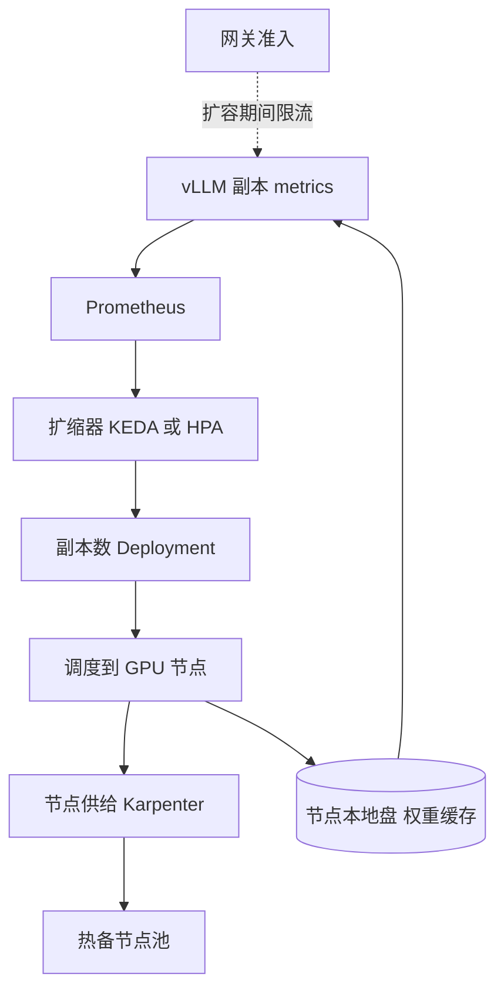

## Q
**全景**｜完整答案 · GPU 集群扩缩容与冷启动

面试官：「一个推理平台服务 3 个模型（8B、70B 和一个嵌入模型）。白天峰值是夜里的 4 倍，偶尔有突发。设计扩缩容：按什么指标扩、新副本多久能接流量、怎么平衡成本和延迟。」

## A
**一句话。** 按"排队与显存"这类直接反映 SLO 的引擎指标扩缩，而不是 CPU 或 GPU 利用率；把冷启动从十几分钟压到一两分钟（预置节点、镜像预热、权重放本地盘或并行流式加载、启动缓存）；保留按突发幅度算出的保底副本和热备池，缩容慢、扩容快，并让准入控制兜住扩容来不及的那几分钟。

**几个词。** 副本是一份完整加载了模型的部署，70B 模型用 16 位存的权重约 140 GB，要 2–4 张 80 GB 显存的卡；冷启动是从"决定扩容"到"新副本能接流量"的时间；KV 缓存是引擎为每个进行中的请求保存的中间计算结果，占用显存。

**需求。**
- **延迟：** 首字 p95 < 1 s；扩容期间允许短暂变差，但不允许大面积 5xx。
- **反应：** 流量在 10 分钟内翻倍时能跟上；新副本 2 分钟内就绪（目标）。
- **成本：** 低谷时 GPU 利用率不低于 40%，不长时间为峰值空付钱。
- **规模：** 70B 池峰值 40 个副本（160 张卡），低谷 10 个。

**整体架构。**

**45 分钟路线。**

|时间|做什么|
|---|---|
|0–5 分|需求：峰谷比、突发、冷启动目标、成本目标|
|5–10 分|估算：每副本容量、峰值副本数、冷启动各段耗时|
|10–18 分|架构：指标 → 扩缩器 → 调度 → 节点供给 → 权重缓存|
|18–38 分|深挖：扩缩信号、冷启动拆解、保底与缩容|
|38–45 分|测试与演练、成本账|

**必讲深挖。**
- **扩缩信号：** 每副本在途请求数（运行中加等待中）为主，等待数、KV 缓存占用、首字延迟 p95 作额外触发；GPU 利用率为什么骗人。
- **冷启动：** 节点供给、镜像拉取、权重下载、加载进显存、预热，各段耗时和对应手段。
- **保底、热备与缩容：** 保底副本数按"冷启动期间可能到来的突发"计算；缩容排空在途请求；用低价可抢占实例跑批量。

**级别期望。**
- **中级：** 用 HPA 按某个指标扩缩，知道冷启动慢。
- **高级：** 选对信号、把冷启动拆开逐段优化、算出保底副本、讲清缩容排空和抖动。
- **Staff：** 多模型共享 GPU 的调度、预留与按需实例的采购组合、跨区域容量、预测式扩容。
