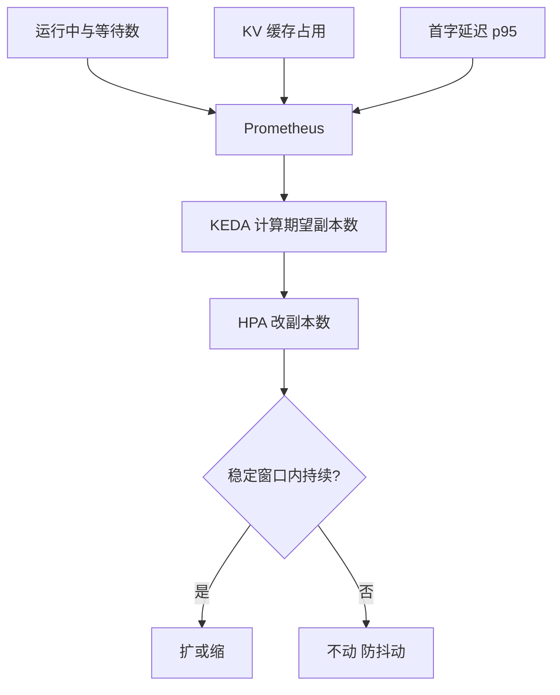

## Q
**深挖：按什么指标扩缩**｜完整答案 · GPU 集群扩缩容与冷启动

面试官：「普通服务按 CPU 利用率扩缩。为什么大模型推理不能按 CPU 或 GPU 利用率扩？你选什么指标、目标值怎么定、用什么组件实现？」

## A
**一句话。** 用直接反映"副本还能接多少"的引擎指标：每副本在途请求数（运行中加等待中）为主，等待数、KV 缓存占用和首字延迟 p95 作为额外的扩容触发；目标值由压测里"SLO 刚好满足"的那个负载点倒推；用 KEDA 或 HPA 加 Prometheus 适配器读取这些指标。

**为什么利用率骗人：**
- **CPU：** 推理在 GPU 上，CPU 几乎闲着。
- **GPU 利用率：** NVIDIA 报的 "GPU 利用率"是"采样时间内有没有任何计算在跑"的比例。只跑 5 路请求时 GPU 也一直有计算在跑，读数接近 100%，却远没到容量；而且解码阶段受显存带宽限制，算力单元大部分空闲时利用率也可能显示很高。它对"还能不能再接请求"几乎没有区分度。

**步骤。**
1. **定目标值：** 压测得出单副本在 8 请求/s 时刚好满足 SLO；每个请求平均持续约 12.5 秒，按利特尔定律在途约 8 × 12.5 = 100 路，此时 KV 缓存占用约 80%。就把"每副本在途 90 路"（留一点余量）作为目标。
2. **采集：** Prometheus 采集每个副本的 `vllm:num_requests_running`、`vllm:num_requests_waiting`、`vllm:kv_cache_usage_perc` 和 `vllm:time_to_first_token_seconds` 直方图。
3. **计算：** KEDA 的 Prometheus 触发器用一个查询（全池运行中加等待中之和）和阈值 90，换算成期望副本数 = ⌈ 全池在途数 ÷ 90 ⌉，交给 HPA。再加第二个触发器：每副本平均等待数超过 2 或 KV 占用超过 90% 时额外扩容。多个触发器时取需要副本数最多的那个。不能只用等待数：副本满载但恰好没人排队时等待数为 0，会被误判为可以缩容。
4. **防抖动：** HPA 的 `behavior` 里扩容不设或只设很短的稳定窗口，并允许一次加多个副本（比如每分钟最多加 100%）；缩容设长稳定窗口（`scaleDown.stabilizationWindowSeconds` 默认 300 秒，大模型常设到 10–30 分钟），每次只减一点。
5. **其他框架：** Ray Serve 用 `autoscaling_config` 里的 `target_ongoing_requests`（每副本在途请求目标），KServe 的 `InferenceService` 用 `minReplicas`、`maxReplicas`、`scaleMetric`、`scaleTarget`。思路相同：按在途或排队请求数扩。

**故障与处理。**
- **指标为 0 的错觉：** 等待数在请求被网关拒绝时也为 0（因为没进来）。所以要同时看网关的拒绝率，拒绝率上升也要扩容。
- **长度分布变化：** 用户开始大量发长文档，每请求代价变大，同样的等待数意味着更长的等待。补充按"首字延迟 p95 超过 0.8 秒"触发的扩容规则。
- **指标采集失败：** Prometheus 断了，HPA 拿不到指标就不动。扩缩器异常要报警，并保证保底副本足够撑一段时间。

**为什么这样，不那样。**
- **不只按延迟扩：** 延迟是结果，变差时用户已经受影响了；排队数是先行指标。
- **不按请求速率扩：** 请求的代价差别巨大，同样每秒 8 个请求，长短输入需要的容量可以差几倍。

**数字。** 从突发开始到扩容决策：采集间隔 15 秒 + KEDA 轮询 15–30 秒，约半分钟；真正的瓶颈是后面的冷启动。
