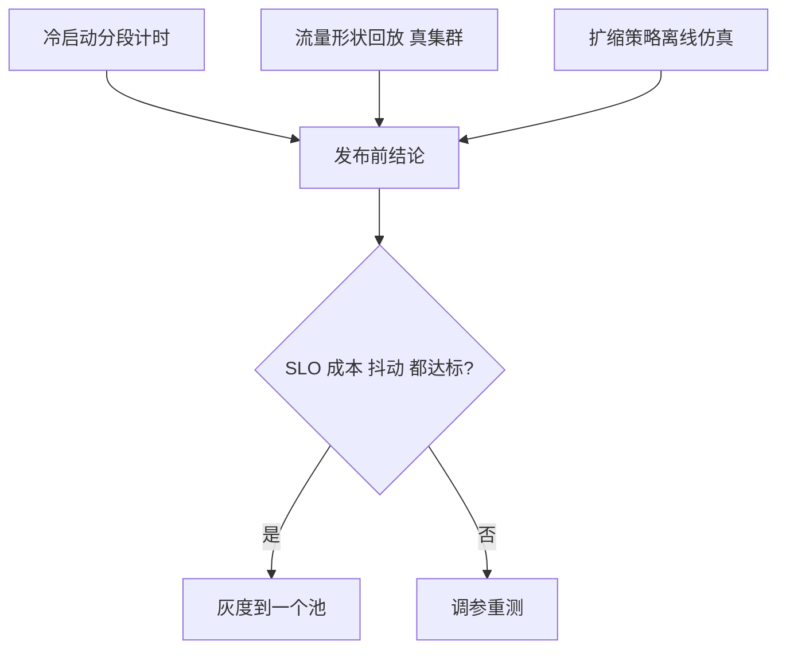

## Q
**测试**｜完整答案 · GPU 集群扩缩容与冷启动

面试官：「扩缩容策略改了，比如目标值从 2 调到 3、或者冷启动换了加载方式。上线前你怎么测试它真的能跟上突发、不抖动、也不浪费？」

## A
**一句话。** 三类测试：冷启动分段计时（每次发布都量）、按真实流量形状的回放测试（看扩容是否跟上、SLO 是否守住）、扩缩器逻辑的离线仿真（用历史指标重放，比较新旧策略的副本数曲线和成本）。

**1. 冷启动分段计时。**
- **做法：** 在启动流程里打时间点：Pod 被调度、镜像拉完、权重开始读取、权重读完、引擎就绪、第一个请求成功。每次发布、每种模型都跑一次，结果入库。
- **断言：** 每段不超过预算（如权重读取 ≤ 90 秒、总时长 ≤ 2 分钟，节点已存在的前提下）；与上一版本相比任何一段退化超过 20% 就阻断。
- **变体：** 节点本地缓存命中和未命中各测一次；同时启动 10 个副本测"雷群下载"。

**2. 流量形状回放（真集群，几小时）。**
- **阶跃：** 流量在 1 分钟内从 30% 跳到 100%，测：扩容决策用了多久、新副本多久就绪、期间首字延迟 p95 和 429 比例。
- **斜坡：** 30 分钟内从低谷爬到峰值（模拟早高峰），断言全程 SLO 达标。
- **锯齿：** 流量每 5 分钟在 50% 和 80% 之间来回，断言副本数没有跟着来回跳（抖动），扩缩事件次数低于阈值。
- **长度突变：** 请求速率不变但平均输入长度翻 4 倍，检查扩缩器能否靠首字延迟规则补上。

**3. 扩缩器离线仿真。**
- **做法：** 用过去 30 天的每分钟指标（请求速率、长度分布）和测得的单副本容量、冷启动时间，写一个模拟器重放：每分钟按策略算副本数，按容量算是否满足 SLO。
- **比较：** 新旧策略的 SLO 违约分钟数、GPU 小时数（成本）、扩缩事件次数。改目标值就是在这三者之间做取舍，用数字决策。

**故障演练。**
- **Prometheus 断开：** 扩缩器拿不到指标，副本数应保持不变而不是缩到最小。
- **节点申请失败：** 模拟云厂商没有库存，确认报警触发、准入控制生效、低优先级流量被限。
- **启动失败：** 放一个损坏的权重文件，确认不会无限重启循环，并有明确报警。

**指标看板。** 每个池的期望副本数、就绪副本数、两者差值的持续时间（"扩容欠账"）、冷启动分段耗时、按小时的 GPU 利用率和成本。
