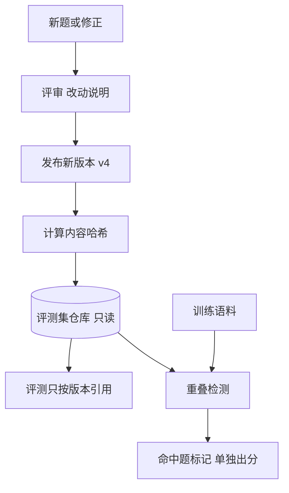

## Q
**深挖：评测集版本、保留集与污染**｜完整答案 · 模型评测平台

面试官：「上个月数学评测分数 72，这个月 78，后来发现有人改了评测集里的几十道题，而且有些题出现在新模型的训练数据里。评测集应该怎么管？」

## A
**一句话。** 评测集像代码一样管理：不可变的版本（`math@v3`），每次修改出新版本并写变更说明，结果必须记录用的是哪个版本；公开评测集之外维护从不公开的私有保留集；每个新模型都要做训练数据重叠检测，命中的题单独标出。

**步骤。**
1. **版本与哈希：** 每个评测集版本是一个只读文件（JSONL），记录每道题的 ID、输入、标准答案或评分规则、标签（难度、主题、语言）。版本的内容哈希写进每次运行的结果。
2. **修改流程：** 修错题、删歧义题都走评审，发新版本；旧版本永远保留。对比两个模型时，平台拒绝比较用了不同版本的结果，或者自动在两个版本的共同题目上重新算分。
3. **保留集（held-out）：** 一部分题目从不公开、不进任何训练和调参流程，只在发布决策时使用，访问受控、有审计。公开题刷高了而保留集没涨，说明是"刷榜"而不是真变强。
4. **污染检测：** 新模型的训练数据和评测题做 n-gram 重叠检测（比如连续 13 个词相同即命中）或近似去重（MinHash）；命中的题打上"疑似污染"标签，结果里分别给出"全部题"和"去除疑似污染题"的分数。
5. **切片标签：** 每道题带主题、难度、长度、语言标签，结果可以按切片钻取，看退化发生在哪里。
6. **新鲜题：** 定期加入在模型训练截止日期之后才出现的题目（比如新出的竞赛题），作为污染难以触及的参照。

**故障与处理。**
- **评测集被静默修改：** 文件直接被覆盖，分数凭空变化。仓库只读、按哈希引用，运行时校验哈希。
- **答案本身是错的：** 标准答案有误，好模型反而被扣分。对"所有强模型都答错同一个答案"的题自动标出复查。
- **评测集太小：** 200 题的评测集，分数天然波动几个百分点，任何结论都不可靠。平台给出每个分数的置信区间，并对题数过少的评测集提示。

**为什么这样，不那样。**
- **不只用公开基准：** 公开题大概率已经出现在互联网语料里，被训练过；分数高不代表能力强。
- **不允许"顺手修一下题"：** 任何修改都会让历史分数不可比，必须出新版本。
