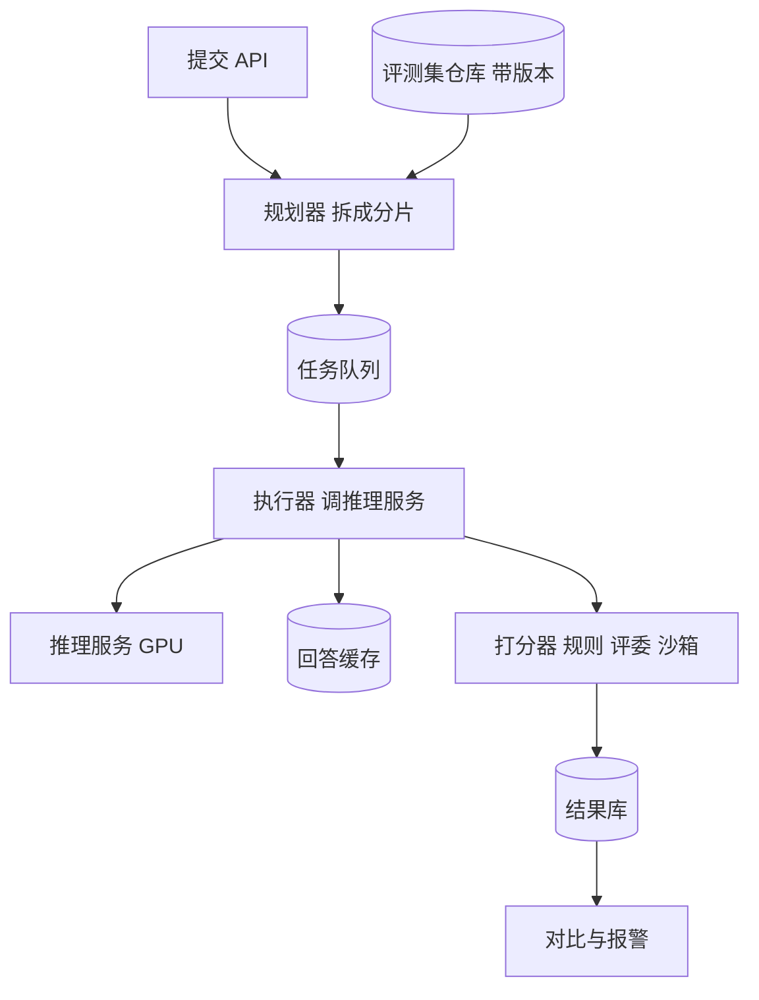

## Q
**全景**｜完整答案 · 模型评测平台

面试官：「研究和平台团队每天要评测几十个模型版本，每次几十个评测集、上万道题。设计一个评测平台：提交评测、调度到 GPU、打分、和基线对比、发现回归就报警。」

## A
**一句话。** 评测被拆成三层：评测运行（一个模型版本 × 一组评测集）→ 分片（每片几百道题）→ 单题；分片由调度器派到 GPU 上的推理服务执行，单题的模型回答按（模型哈希，题目哈希，生成参数）缓存；打分器与生成分离，可以离线重打；结果写进带版本的结果库，与基线做配对比较并自动报警。

**几个词。** 评测集是一组带标准答案或评分规则的题目；基线是拿来比较的参照版本（通常是线上版本）；评委模型是用另一个强大的语言模型按规则给回答打分；配对比较是新旧版本在同一批题上逐题比较，比两个总分直接相减更灵敏。

**需求。**
- **功能：** 提交评测（模型清单 + 评测集列表 + 生成参数）；查看进度；结果对比与切片钻取；回归报警；可复现。
- **规模：** 每天 50 次运行 × 30 个评测集 × 平均 2,000 题 = 300 万次生成，平均每题 1,000 输入、300 输出词元。
- **速度：** 一次标准运行 2 小时内出结果。
- **正确：** 同一配置重跑，分数差在噪声范围内；评测集与结果都可追溯。

**接口。**
- `POST /runs`：`{manifest, suites: ["math@v3", "code@v5"], sampling: {temperature: 0, max_tokens: 1024}, baseline}` 返回 `run_id`。
- `GET /runs/{id}`：状态、进度、每个评测集的分数与置信区间。
- `GET /compare?a=&b=`：逐题差异、切片对比。

**整体架构。**

**45 分钟路线。**

|时间|做什么|
|---|---|
|0–5 分|需求：谁提交、评什么、多快、多准|
|5–10 分|估算：每天生成词元数、需要的 GPU|
|10–18 分|架构：规划、分片、执行、缓存、打分、结果|
|18–38 分|深挖：调度与缓存、评测集版本与污染、打分与统计对比|
|38–45 分|怎么测评测平台本身|

**必讲深挖。**
- **调度与缓存：** 分片、租约与重试、按模型聚合以复用加载好的副本；回答缓存让重跑和换打分器不用重新生成。
- **评测集管理：** 不可变版本、私有保留集、训练数据污染检测。
- **打分与比较：** 精确匹配、代码沙箱执行、评委模型；配对比较与置信区间；只对显著退化报警。

**估算。** 300 万次 × 300 输出词元 = 9 亿输出词元/天；按每卡 2,500 输出词元/s（8B 模型，假设），约 36 万 GPU 秒，即约 100 GPU 小时（全天约 4–5 张卡）；大模型和长输出会高一个数量级，按每天几百到上千 GPU 小时准备，并和线上错峰使用。

**级别期望。**
- **中级：** 跑评测、存分数、做对比。
- **高级：** 分片与缓存、可复现、评测集版本、配对统计、评委偏差。
- **Staff：** 评测作为发布的权威依据、污染治理、成本与覆盖的取舍、评测集的长期演进。
