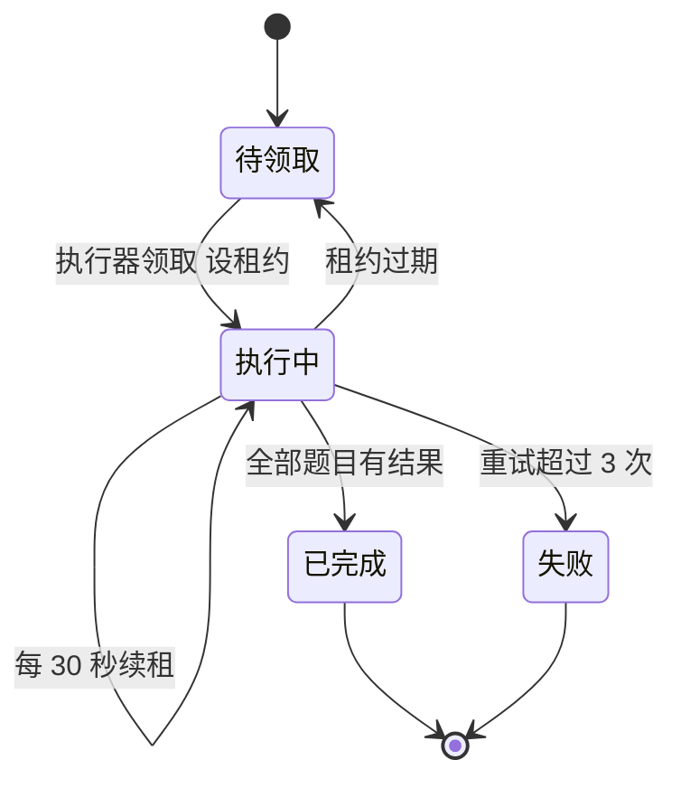

## Q
**深挖：分片调度与回答缓存**｜完整答案 · 模型评测平台

面试官：「一次运行有 6 万道题。执行器中途挂了、推理服务限流了、某道题卡住了，怎么保证每道题恰好算一次结果、整次运行能在 2 小时内完成？」

## A
**一句话。** 规划器把运行拆成几百个分片写进任务表；执行器用租约领取分片（`SELECT ... FOR UPDATE SKIP LOCKED` 并写 `lease_until`），定期续租，挂了租约过期由别的执行器接手；每道题的回答以（模型清单哈希，题目哈希，生成参数哈希）为键写缓存，重做时先查缓存，所以重复执行无害。

**步骤。**
1. **规划：** 6 万题按每片 200 题切成 300 个分片，写入任务表（`shard_id`、`run_id`、`status`、`lease_until`、`attempts`）。
2. **领取：** 执行器执行 `UPDATE shards SET status='running', lease_until=now()+interval '2 min' WHERE id = (SELECT id FROM shards WHERE status='pending' OR (status='running' AND lease_until < now()) ORDER BY priority LIMIT 1 FOR UPDATE SKIP LOCKED)`，多个执行器并发领取互不阻塞。
3. **执行：** 对分片里的每道题，先查回答缓存；未命中就以有界并发（比如 64 路）调推理服务，拿到回答后写缓存。每 30 秒续租一次。
4. **完成：** 分片所有题都有回答后标记完成，并触发打分。
5. **接手：** 执行器崩溃，租约 2 分钟后过期，别的执行器领到这个分片；已缓存的题直接跳过，只补没做完的。
6. **按模型聚合：** 调度时优先把同一模型的分片派给已经连着这个模型的执行器，避免频繁加载权重。

**故障与处理。**
- **单题卡住：** 某道题让模型输出到 `max_tokens` 上限，要 2 分钟。单题设超时（比如 120 秒），超时记为"生成失败"并打 0 分，同时在结果里单独列出，而不是让整个分片卡住。
- **推理服务限流：** 返回 429 时按 `Retry-After` 退避；评测流量用低优先级，不能挤占线上流量。
- **毒分片：** 某个分片反复失败超过 3 次，标为失败，运行结果标注"不完整"，而不是悄悄少算几百道题。
- **缓存键不全：** 漏掉了生成参数或系统提示，换了温度却命中了旧回答，结果全错。键必须包含所有影响输出的因素，且清单哈希本身就覆盖了模型、分词器和模板。

**为什么这样，不那样。**
- **不一题一个任务：** 6 万个任务的调度开销和数据库压力都太大；分片在一两百题时调度开销可以忽略。
- **不把生成和打分绑在一起：** 换评委模型或改评分规则时，只需重新打分，不用重新生成 6 万次。
- **不用纯消息队列：** 需要按运行查进度、按分片重试和取消，表加租约更直观。

**数字。** 6 万题 × 每题约 10 秒（含排队），64 路并发的单执行器要约 2.6 小时；10 个执行器并行约 16 分钟，瓶颈转到推理服务的容量。
