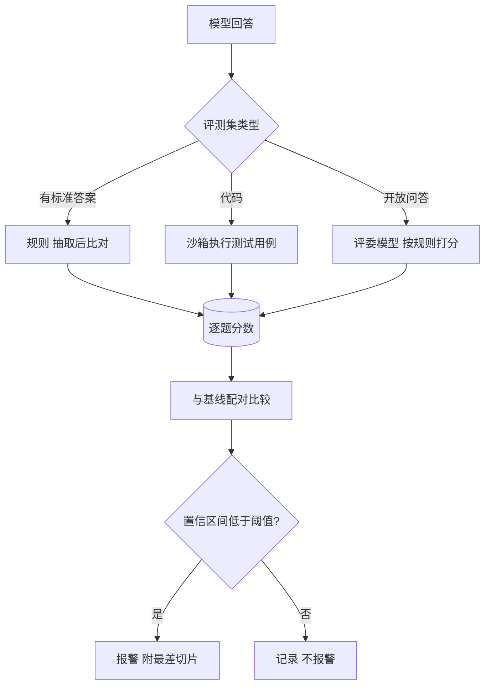

## Q
**深挖：打分器与回归判定**｜完整答案 · 模型评测平台

面试官：「不同评测集要不同的打分方式：数学题比答案、代码题要跑测试、开放问答只能让评委模型打分。平台怎么统一支持？新版本某个评测集掉了 1.5 分，平台什么时候该报警？」

## A
**一句话。** 打分器是可插拔的函数：`score(question, answer) -> {score, details}`，分三类：规则匹配、沙箱执行、评委模型；回归判定用新旧版本在同一批题上的配对比较，给出差值的置信区间，区间整体落在"退化阈值"以下才报警，并按切片钻取。

**三类打分器。**
- **规则：** 先从回答里抽出最终答案（比如最后一个数字，或 `\boxed{}` 里的内容），规范化后与标准答案比较。抽取规则写错是最常见的打分错误，要有单元测试。
- **沙箱执行：** 把生成的代码放进隔离容器（无网络、限 CPU 和内存、限时 10 秒），跑题目自带的测试用例，全部通过得分。沙箱必须防止恶意或失控代码影响平台。
- **评委模型：** 给评委一份评分规则和若干示例，让它对回答打 1–5 分或在两个回答中选更好的。已知偏差：偏好更长的回答、偏好排在前面的回答、偏好和自己风格相近的回答。对策：成对比较时交换顺序各评一次；固定评委模型的版本；定期抽 200 条和人工评分对比一致率。

**回归判定。**
1. **配对：** 同一批题，统计每题新旧分数之差。
2. **置信区间：** 用 bootstrap（有放回地重抽题目几千次，每次算平均差）得到平均差的 95% 区间。比如平均差 −1.5 分，区间 [−2.4, −0.6]。
3. **判定：** 事先定"可接受的最大退化"，比如 1 分。区间上界 −0.6 没有低于 −1，说明退化可能小于 1 分，标为"需关注"；区间整体低于 −1（如 [−3.1, −1.2]）才报警阻断。
4. **切片：** 报警时自动列出差值最大的切片（主题、长度、语言），以及新旧回答差异最大的 20 道题，方便人直接看。

**故障与处理。**
- **温度大于 0 的噪声：** 每题只采样一次，差异里混着随机性。发布评测固定温度为 0；需要采样的评测每题采多次取平均。
- **评委模型被升级：** 分数整体跳变而模型没变。评委版本写进结果，换评委必须重新建立基线。
- **打分器有缺陷：** 答案格式变了（新模型喜欢加单位），规则抽取失败，分数暴跌。对"分数暴跌但回答看起来正常"的情况，抽样人工检查抽取结果。

**为什么这样，不那样。**
- **不直接比两个总分：** 题目难度差异带来的波动远大于模型差异，配对比较能抵消它。
- **不用固定的"下降 X 分就报警"：** 不考虑题数和噪声，小评测集会天天误报。
