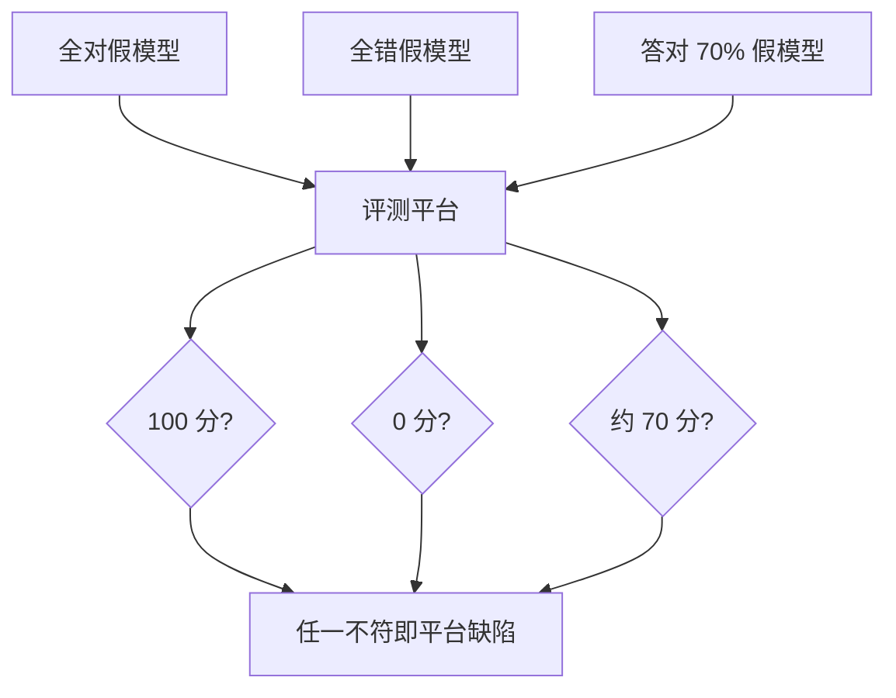

## Q
**测试评测平台本身**｜完整答案 · 模型评测平台

面试官：「发布决策完全依赖这个评测平台的分数。如果平台本身算错了（漏题、打分错、缓存串了），所有决策都是错的。你怎么测试和持续验证它？」

## A
**一句话。** 用"答案已知的假模型"做端到端测试：一个永远返回标准答案的模型应得满分，一个永远返回空的应得零分，一个按设定比例答对的应得到对应分数；再加上打分器的单元测试、重跑一致性检查和与外部工具的交叉核对。

**1. 假模型端到端测试（每次平台发布）。**
- **全对模型：** 一个读评测集、按题目返回标准答案的假推理服务（实现 OpenAI 兼容接口）。期望每个评测集 100 分。低于 100 说明抽取规则、题目对齐或打分器有问题，比如回答顺序错位、某些题被漏掉。
- **全错模型：** 永远返回空字符串或无关文字，期望 0 分（多选题按随机猜的期望值）。高于预期说明打分器太宽松。
- **按比例答对：** 按题目哈希决定是否答对，答对比例 70%，期望分数正好是事先能算出的值。
- **故障模型：** 随机返回 500、超时、超长输出，检查重试、超时和"不完整"标注都正确，分数只基于成功的题并明确标注。

**2. 打分器单元测试。**
- **规则抽取：** 针对 "答案是 42。"、"42.0"、"\\boxed{42}"、"大约 42" 等写用例，明确哪些算对。
- **沙箱：** 死循环要在时限内被杀；尝试联网要失败；写文件不能逃出容器。
- **评委：** 固定一组"明显好"和"明显差"的回答对，评委必须稳定地选出好的那个，一致率低于阈值报警。

**3. 一致性检查（持续）。**
- **重跑：** 同一配置每周重跑一次，分数差应在置信区间内；超出说明有隐藏的随机性或缓存问题。
- **缓存正确性：** 关掉缓存重跑一个小评测集，结果应与开缓存时完全一致。
- **交叉核对：** 对公开评测集，用 lm-evaluation-harness 之类的独立工具跑同一个模型，分数应与平台接近；差距大就逐题找原因。

**4. 数据完整性。**
- **题数守恒：** 每次运行的"已打分 + 失败"题数必须等于评测集版本的总题数。
- **结果不可变：** 运行完成后结果只读；重算生成新的结果版本。

**为什么这样。** 评测平台是"测试的测试"，它的缺陷会悄悄污染每一个发布决策；假模型让"正确答案"变成已知，从而能断言平台本身对不对。
