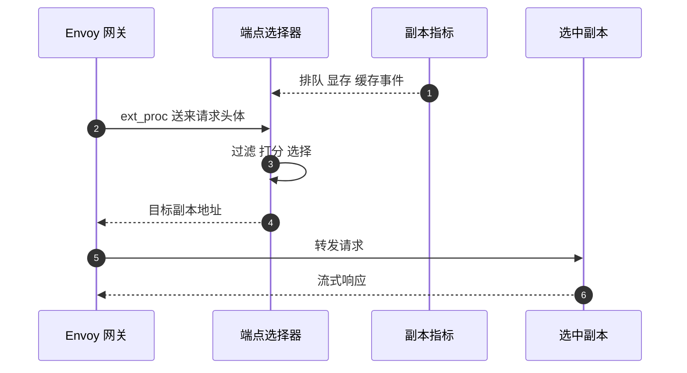

## Q
**深挖：端点选择（过滤、打分、选择）**｜完整答案 · 多模型多租户网关

面试官：「同一个模型池有 16 个副本。普通负载均衡用轮询或最少连接，为什么不够？你的端点选择器具体按什么选？」

## A
**一句话。** 大模型请求的代价差上千倍，而且副本的前缀缓存决定了"同一个请求在不同副本上要算多少"，所以选择器要读每个副本的实时状态：先过滤掉不能服务的副本，再按排队长度、显存占用和前缀命中加权打分，选分最高的；最优副本过热时退回按负载选，避免热点。

**步骤。**
1. **接入：** Kubernetes Gateway API 的推理扩展（Inference Extension）定义了 `InferencePool` 资源，表示"运行同一个模型的一组 Pod"。网关（Envoy）通过外部处理（`ext_proc`）把请求交给这个池的端点选择器（endpoint picker），由它决定发给哪个 Pod。
2. **收集状态：** 选择器每隔几十毫秒拉取每个副本的指标：`vllm:num_requests_waiting`、`vllm:num_requests_running`、`vllm:kv_cache_usage_perc`，以及已加载的 LoRA 适配器列表；开启 KV 事件的引擎还会推送"哪些前缀块存在、哪些被淘汰"。
3. **过滤：** 去掉不健康的副本；请求用某个适配器时，优先保留已加载它的副本；显存占用超过 95% 的副本暂时排除。
4. **打分：** 例如 分数 = 0.5 × 前缀命中比例 + 0.3 × (1 − 归一化排队长度) + 0.2 × (1 − 显存占用)。前缀命中比例 = 这个请求开头有多少词元已在该副本的缓存里 ÷ 请求总词元。
5. **选择：** 取最高分；分数接近时随机选一个，避免所有选择器同时扑向同一个副本。
6. **转发：** 网关把请求发给选中的 Pod 并流式返回。

**故障与处理。**
- **指标过期：** 突发时 50 ms 前的指标已经不准，很多请求同时被派到"刚才最空"的副本。选择器在本地记录"已派出但还没反映在指标里"的请求数并计入打分。
- **热门前缀热点：** 所有请求共用一个 3,000 词元的系统提示，前缀分数让它们都去同一个副本。设一个排队上限，超过就忽略前缀分数，按负载选。
- **选择器故障：** 选择器挂了网关无法转发。部署多个副本；网关配置"选择器不可用时退回普通负载均衡"（fail-open）还是"拒绝"（fail-close），按业务决定。
- **副本缩容：** 被缩掉的副本上的前缀缓存随之消失，短时间内首字延迟上升，属正常现象，但要在扩缩容时监控。

**为什么这样，不那样。**
- **不用一致性哈希按会话固定副本：** 能命中缓存，但完全不看负载，长对话用户集中的副本会被压垮；需要"有界负载的一致性哈希"或打分法。
- **不把选择逻辑放进每个客户端：** 客户端看不到全局状态，且无法统一升级。

**数字。** 前缀命中时，一个 3,000 词元的系统提示不必重新预填充，首字延迟可以从约 300 ms 降到几十毫秒；选择器每次决策的预算是 1–2 ms。
