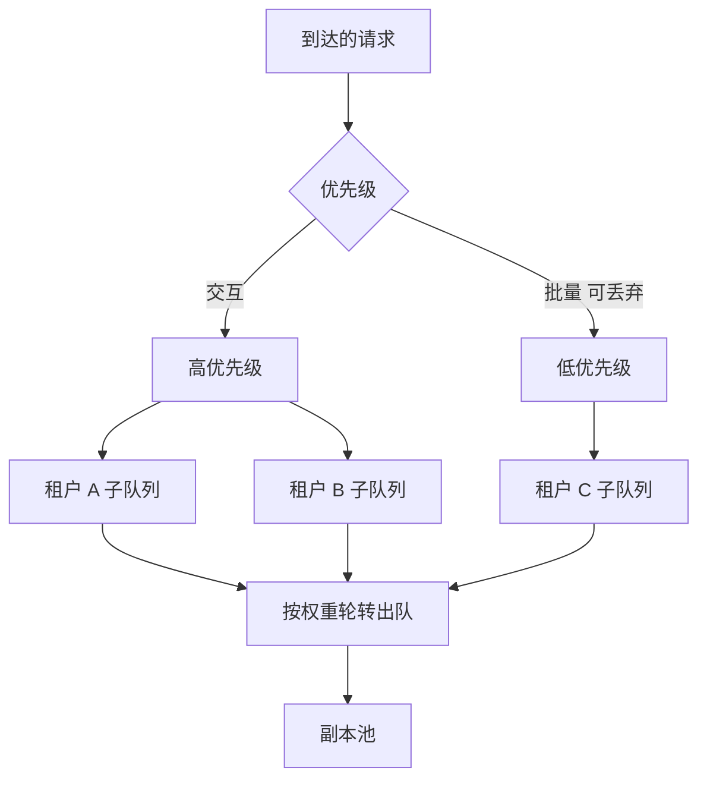

## Q
**深挖：多租户公平与优先级**｜完整答案 · 多模型多租户网关

面试官：「一个团队突然跑一个离线任务，每秒发 300 个请求，把共享模型池占满，其他团队的聊天机器人首字延迟从 0.5 秒涨到 8 秒。配额没超，因为它的配额本来就很大。你怎么设计，让一个租户不能拖垮其他租户？」

## A
**一句话。** 配额只限制"总量"，不限制"同一时刻占多少"。在每个池前加一个按租户分组的**加权公平队列**：每个租户一个子队列，按权重轮流出队，按词元而不是按请求计；再叠加优先级：交互请求先于批量请求，过载时先丢弃可丢弃的请求。

**步骤。**
1. **分类：** 网关根据请求头 `x-priority` 或 API key 的配置，把请求标成交互或批量。批量请求标为可丢弃（sheddable）。
2. **入队：** 每个池有一个调度队列，按（优先级，租户）分子队列；每个子队列有长度上限。
3. **出队：** 只有当池里有空位（某个副本的运行中请求数低于上限）时才出队，先看高优先级。同一优先级内用赤字轮转（deficit round robin）：每轮给每个租户发"额度"，额度 = 权重 × 一个基数（比如 2,000 词元）；请求的预计代价（输入词元 + 预计输出）不超过累积额度就出队，否则等下一轮。这样大请求不会因为"一次一个请求"的轮转而占便宜。
4. **过载时：** 低优先级子队列先拒绝（429 带 `Retry-After`）；高优先级子队列满了再拒绝高优先级请求，从超出自己公平份额最多的租户开始拒。
5. **反馈：** 每个租户的排队时间、被拒次数进指标，让租户知道自己被限的原因。

**故障与处理。**
- **公平但浪费：** 只有一个租户在用时，严格按份额会让卡空着。用"工作保持"（work-conserving）的公平：没人和你抢时你可以用全部容量，有人来了再按权重分。
- **饥饿：** 高优先级持续满载时，批量请求永远出不了队。给批量请求保底份额（比如 10%），或者把批量任务引到夜间和专门的池。
- **队列在网关、引擎里也排队：** 如果网关一股脑把请求发给引擎，公平就失效了，因为引擎内部按到达顺序处理。网关只在副本有空位时才放行，让排队发生在网关这一层。

**为什么这样，不那样。**
- **不只靠配额：** 配额是"每分钟多少"，挡不住"同一秒全部涌来"。
- **不给每个租户独立的副本：** 300 个团队各自一组 GPU，利用率极低；共享池加公平调度能用更少的卡。
- **不按请求数轮转：** 一个 10 万词元的请求和一个 100 词元的请求代价差千倍。

**数字。** 目标是：任何租户的突发都不能让其他交互租户的首字延迟 p95 上升超过 20%；用一个"嘈杂邻居"压测来验证。
