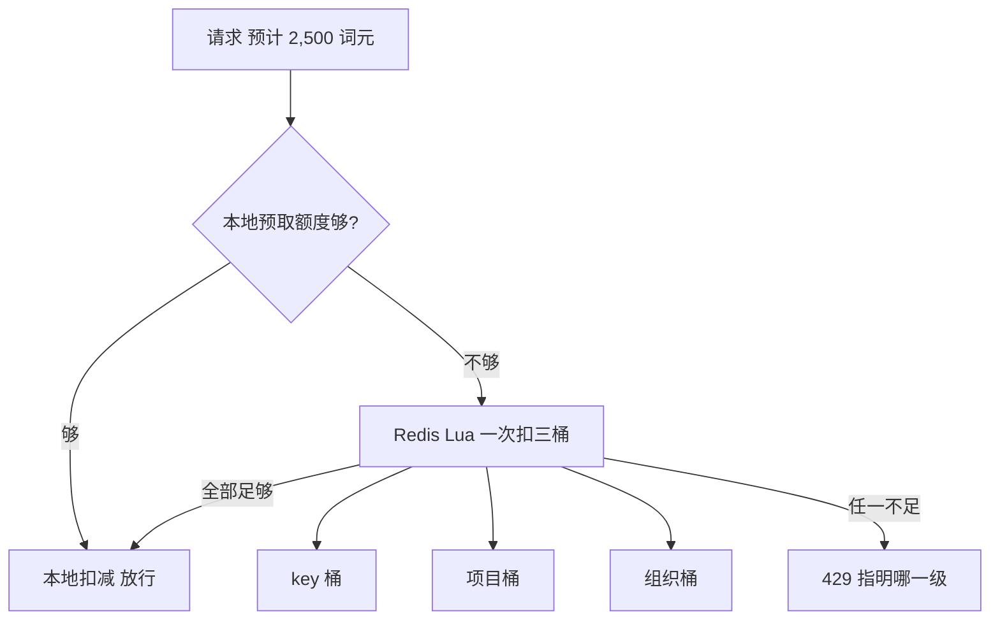

## Q
**深挖：层级配额与分布式限流**｜完整答案 · 多模型多租户网关

面试官：「配额有三级：组织每分钟 500 万词元，下面每个项目 100 万，每个 API key 20 万；而且按模型分开算。网关有 30 个实例，分在 3 个区域。怎么做到又准又不拖慢请求？」

## A
**一句话。** 每个（层级，主体，模型）是一个令牌桶，请求要同时从 key、项目、组织三个桶里扣；计数集中在每个区域的 Redis 里，用一段 Lua 脚本原子地一次扣三个桶；为了少访问 Redis，网关实例可以一次预取一小块额度在本地消费；跨区域的总量按份额分配并定期再平衡。

**步骤。**
1. **键设计：** `q:{org}:{model}:tpm`、`q:{org}:{project}:{model}:tpm`、`q:{org}:{project}:{key}:{model}:tpm`。用 Redis Cluster 时，把组织 ID 放进哈希标签 `{org}`，保证同一组织的三个键落在同一个分片，Lua 脚本才能原子地操作它们。
2. **令牌桶脚本：** 读出每个桶的（余额，上次补充时间），按"每秒补充 = 每分钟上限 ÷ 60"补到当前，三个桶都够才一起扣，否则一个都不扣并返回是哪一级不够。
3. **本地预取：** 高流量的 key 每次从 Redis 拿 5,000 词元的"批发额度"，本地扣完再拿。Redis 访问次数降到原来的几十分之一；代价是最多有"实例数 × 5,000"的额度在路上，略不准。低流量的 key 不预取，直接扣。
4. **结算：** 请求结束后按实际用量把差额退回（或补扣），保证长期准确。
5. **跨区域：** 组织的总额度按各区域过去一小时的用量比例分配给 3 个区域的 Redis，每分钟再平衡一次。某区域用完而其他区域有余时，下一次再平衡时调整。
6. **返回信息：** 429 响应里写明是哪一级、哪个模型的配额不足，以及 `Retry-After`，让调用方知道该找谁加额度。

**故障与处理。**
- **Redis 分片故障：** 改用实例本地限流（该 key 的额度 ÷ 实例数），报警但不停止服务；恢复后从本地记录回补计数。
- **热点组织：** 一个大组织所有请求都打到同一个 Redis 分片。本地预取能把访问量降一个数量级；仍不够时把这个组织的项目拆到不同分片，组织级额度改为定期汇总而不是每次扣。
- **时钟问题：** 补充计算用 Redis 服务器的时间（`TIME` 命令），而不是 30 个网关实例各自的时钟。

**为什么这样，不那样。**
- **不用固定窗口计数：** 每分钟零点重置，会让调用方在 59 秒和 0 秒各打满一次，瞬间两倍流量；令牌桶平滑。
- **不做全球强一致计数：** 跨区域每个请求同步一次要加几十到上百毫秒，配额允许分钟级的小误差。
- **不只在 key 一级限流：** 一个组织创建 100 个 key 就能绕过限制。

**数字。** 2,000 请求/s，如果每个请求访问 Redis 两次（预扣和结算），约 4,000 次/s，一个 Redis 分片也能扛；预取主要是为了降延迟（省掉约 0.5–1 ms 的往返）和隔离热点。
