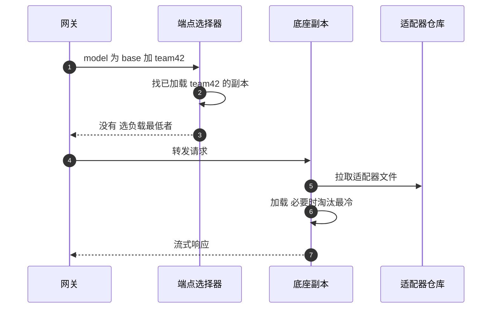

## Q
**深挖：上百个微调版本怎么部署和路由（多 LoRA）**｜完整答案 · 多模型多租户网关

面试官：「100 个团队各自在同一个 8B 底座上做了 LoRA 微调。每个版本都单独部署一组 GPU 太贵，大部分版本一天只有几百个请求。怎么部署？网关怎么路由？」

## A
**先说 LoRA。** LoRA（low-rank adaptation）微调时不改底座模型的权重，只额外训练一小组参数（适配器），推理时把它"挂"在底座上一起算。一个 8B 底座的权重约 16 GB，一个适配器通常只有几十到几百 MB。

**一句话。** 让少数底座副本同时挂多个适配器，同一批次里不同请求可以用不同适配器；网关把请求路由到"已经加载了这个适配器"的副本，没有就选一个负载低的副本按需加载；热门适配器常驻、冷门的按最近最少使用（LRU）淘汰。

**步骤。**
1. **引擎配置：** vLLM 用 `--enable-lora` 开启，`--max-loras`（一个批次里最多同时用几个适配器，比如 8）、`--max-lora-rank`（适配器规模上限）、`--max-cpu-loras`（在 CPU 内存里缓存多少个）。启动时可用 `--lora-modules team42=s3路径` 预加载；也可在运行时通过加载适配器的管理接口按需加载（需要显式开启运行时更新的环境变量）。
2. **模型目录：** 记录每个适配器属于哪个底座、存在哪、版本号；`model: "llama-8b:team42"` 解析成（底座池，适配器 ID）。
3. **路由：** 端点选择器知道每个副本加载了哪些适配器。优先选"已加载且负载不高"的副本；没有时选负载最低的副本，让它加载。
4. **常驻与淘汰：** 按请求量排名，前 20 个适配器在每个副本上常驻；其余按 LRU 在 GPU 显存、CPU 内存、对象存储三级之间移动。
5. **发布：** 新版本适配器作为新 ID 上线（`team42-v3`），别名 `team42` 切换指向即可上线或回滚，不需要重启底座副本。

**故障与处理。**
- **冷加载延迟：** 从对象存储拉 200 MB 适配器要几秒，首个请求的首字延迟明显变高。对日请求量大于阈值的适配器预加载；冷门的在接口文档里说明首次请求较慢。
- **适配器颠簸：** 一个批次可同时用的适配器数有上限，活跃适配器太多时不断换入换出，吞吐下降。按适配器把流量分组到不同副本（亲和性），减少每个副本上的活跃适配器数。
- **底座不匹配：** 适配器是在另一个底座版本上训练的，挂上去也能运行但输出是错的。目录里强制登记底座的哈希，加载时校验。
- **一个坏适配器：** 某团队的适配器输出异常，只影响用它的请求；但如果它导致引擎崩溃，会波及同副本的其他团队。新适配器上线前在隔离的副本上跑一组冒烟用例。

**为什么这样，不那样。**
- **不把适配器合并进底座再单独部署：** 每个版本 16 GB、至少一张卡，100 个版本就是 100 张卡，大部分时间空着。
- **不全部挂在每个副本上：** 显存放不下，批次里同时用的适配器太多也会降低吞吐。

**数字。** 100 个适配器 × 200 MB = 20 GB，可以全放在每台机器的 CPU 内存里；GPU 上只放最活跃的几个到十几个。挂适配器会让每步计算多出一些开销，具体比例以压测为准。
