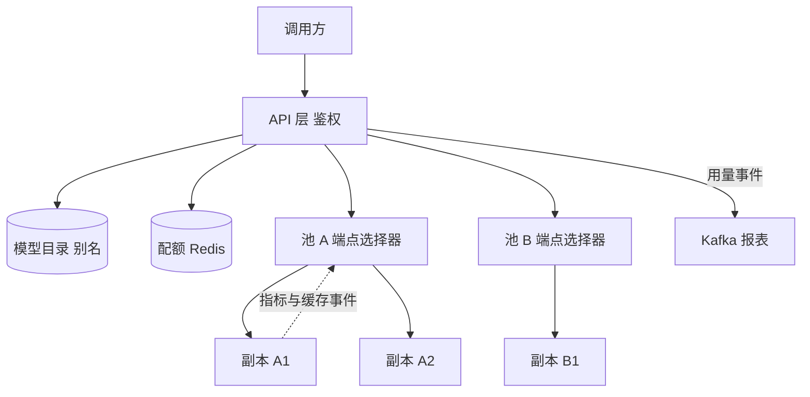

## Q
**全景**｜完整答案 · 多模型多租户网关

面试官：「公司内部有 20 个模型（几个底座模型加上百个微调版本），300 个团队在用。设计一个统一网关：按模型路由、按租户配额和限流、保证公平、尽量命中缓存。」

## A
**一句话。** 网关分两段：前段是无状态的 API 层，负责鉴权、把"模型名"解析成"副本池"、按租户扣层级配额；后段是每个副本池前面的端点选择器，按排队长度、显存占用和前缀缓存命中给每个副本打分，并在过载时按优先级和租户公平地排队或拒绝。

**几个词。** 租户（tenant）是一个使用方团队或客户；副本池是同一个模型的一组副本；微调版本常用 LoRA（只训练一小组附加参数，挂在底座模型上用，文件只有几十到几百 MB）；前缀缓存是引擎对相同开头的输入复用已有计算结果。

**需求。**
- **功能：** OpenAI 兼容接口；按 `model` 字段路由，支持别名（`support-bot` → 某个具体版本）；按组织、项目、API key 三级配额；优先级；用量报表。
- **非功能：** 网关自身增加的延迟 p99 < 10 ms；单个租户不能拖垮其他租户；某个模型池故障不影响其他模型。
- **规模：** 峰值 2,000 请求/s、每秒 40 万输出词元，分布在 20 个池上，最热的池占 50%。

**接口。**
- `POST /v1/chat/completions`：`model` 可以是别名或 `base:adapter` 形式；可选头 `x-priority: interactive | batch`。
- `GET /v1/models`：按调用方权限列出可用模型。
- 管理接口：`PUT /admin/aliases/{name}`（切换别名指向，用于发布与回滚）、`PUT /admin/quotas/{tenant}`。

**整体架构。**

**45 分钟路线。**

|时间|做什么|
|---|---|
|0–5 分|需求：多模型、多租户、公平、缓存|
|5–10 分|估算：每池词元吞吐、热点池、网关开销|
|10–15 分|接口、别名、模型目录|
|15–22 分|架构：API 层与每池端点选择器两段|
|22–40 分|深挖：端点选择、公平与优先级、层级配额、多 LoRA|
|40–45 分|测试、故障隔离、扩展到外部模型提供商|

**必讲深挖。**
- **端点选择：** 先过滤（模型或适配器已加载、健康），再打分（排队长度、显存占用、前缀命中），选最高分；用 Kubernetes Gateway API 推理扩展的 `InferencePool` 和端点选择器实现。
- **公平与优先级：** 每池一个按租户分组的加权公平队列；交互请求优先，批量请求在过载时先被丢弃。
- **层级配额：** 组织、项目、key 三级令牌桶，按词元扣减，Redis 集中计数加本地预取。
- **多 LoRA：** 上百个微调版本共享少数底座副本，按适配器的亲和性路由，冷适配器按需加载。

**级别期望。**
- **中级：** 按模型名路由、按租户限流。
- **高级：** 负载与缓存感知的选择、公平队列、按词元的层级配额、别名驱动的发布与回滚。
- **Staff：** 多 LoRA 的容量规划、跨团队成本分摊、外部提供商兜底、网关自身的故障隔离与发布。
