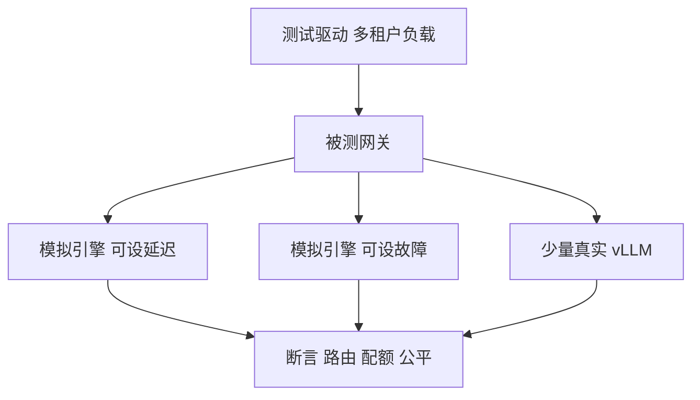

## Q
**测试**｜完整答案 · 多模型多租户网关

面试官：「网关上线前，你怎么证明它路由对、配额准、公平真的生效，而且它自己不会成为瓶颈或单点？」

## A
**一句话。** 用假副本把网关和 GPU 解耦：大部分测试用一个"模拟引擎"（按设定的延迟和指标返回假词元）在 CPU 上跑，便宜、可控、可重复；只有缓存命中和端到端延迟这类依赖真实引擎的测试才上 GPU。

**路由正确性。**
- **别名与目录：** 每个别名解析到预期的池和适配器；切换别名后，新请求在 1 秒内去新版本，在途请求不受影响。
- **过滤：** 把某个模拟副本设为不健康或显存 99%，断言它不再收到新请求。
- **前缀亲和：** 1,000 个共享同一系统提示的请求，在真实引擎上测缓存命中率（`vllm:prefix_cache_hits` ÷ `vllm:prefix_cache_queries`）高于随机路由；同时最热副本的排队长度不超过阈值。

**配额准确性。**
- **精确边界：** key 配额 20 万词元/分钟，发出正好 20 万和 20 万零 1 个词元的请求，断言后者被拒且 429 指明是 key 级。
- **层级：** 同一项目下 6 个 key 各发 20 万，项目上限 100 万，断言第 6 个开始被项目级拒绝。
- **并发：** 30 个网关实例同时发请求，总放行量与配额的误差不超过预取块大小 × 实例数。
- **Redis 故障：** 断开 Redis，断言降级为本地限流、服务不中断，恢复后计数回补。

**公平与优先级（嘈杂邻居测试）。**
- 租户 A 以 10 倍于份额的速率发批量请求，租户 B、C 以正常速率发交互请求。
- 断言：B、C 的首字延迟 p95 上升不超过 20%；A 的批量请求被限速或被拒，但不会饿死（保底份额内仍有吞吐）。

**网关自身。**
- **开销：** 在模拟引擎（零延迟）后面压测，网关增加的延迟 p99 小于 10 ms，找出单实例能扛的最大流数。
- **长连接：** 6,000 路长时间流式连接，网关内存是否稳定；滚动重启时连接按预期排空。
- **选择器故障：** 杀掉端点选择器，按配置要么退回普通负载均衡、要么快速失败，不能挂起。

**生产验证。** 每个区域每分钟用探测 key 调每个热门模型一次，检查路由到的模型版本和返回头里的配额信息正确。
