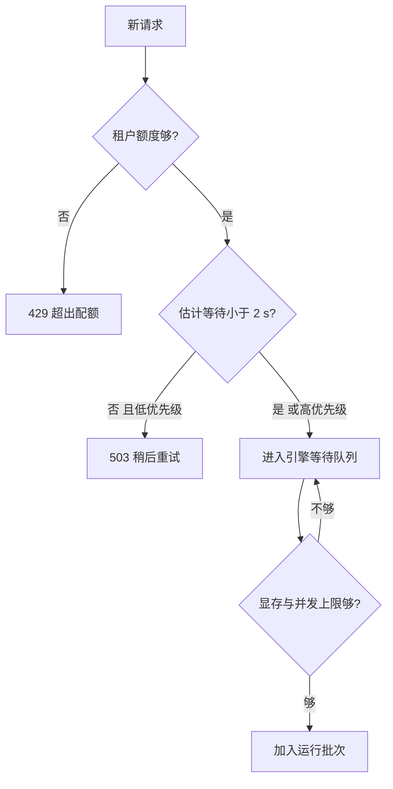

## Q
**深挖：调度、准入与过载**｜完整答案 · LLM 推理服务

面试官：「流量突然变成平时的 3 倍，GPU 不可能马上翻倍。你的系统怎么决定谁先跑、谁排队、谁被拒？怎么避免所有人一起变慢？」

## A
**一句话。** 两级准入：副本内由引擎按显存决定能同时跑多少路；副本外由路由器按每个副本的排队长度和预计等待时间决定接收还是返回 429。超出容量的部分**早拒**，并按优先级先拒低优先级，让被接收的请求仍然满足 SLO。

**先说为什么会"所有人一起变慢"。** 引擎用连续批处理把很多请求放在同一批里一起算，每一步给每个请求各生成一个词元。批越大，每一步越慢：并发从 100 路加到 300 路，每个词元的间隔可能从 30 ms 涨到 80 ms，所有用户都超过 50 ms 的目标；显存也会被占满，引擎只好把某些请求踢出去稍后重算（抢占，preemption），更慢。

**步骤。**
1. **租户配额：** 网关先查这个租户每分钟的词元额度（令牌桶），超了直接 429，不占用任何 GPU 资源。
2. **全局排队判断：** 路由器从每个副本的 `/metrics` 读取 `vllm:num_requests_waiting`、`vllm:num_requests_running` 和 `vllm:kv_cache_usage_perc`，估算新请求要等多久。所有候选副本的估计等待都超过阈值（比如 2 秒，即首字延迟预算的一大半）时，低优先级请求立即返回 503 和 `Retry-After`；高优先级仍然接收。
3. **引擎内准入：** vLLM 用 `--max-num-seqs`（同时运行的最大请求数）和 `--max-num-batched-tokens`（每一步最多处理的词元数）限制批大小；KV 缓存块不够时，新请求留在等待队列。启动参数 `--gpu-memory-utilization`（默认 0.9）决定多少显存给权重和 KV 缓存。
4. **优先级：** vLLM 可用 `--scheduling-policy priority`，请求里带 `priority` 字段，付费或交互请求排在批量请求前面。
5. **扩容同时进行：** 排队长度持续升高触发扩容，但新副本要几分钟才就绪，所以准入必须独立于扩容生效。

**故障与处理。**
- **队列无限长：** 不设上限时请求排在后面等 60 秒才开始，最终超时，GPU 却为它算了预填充。队列长度和最长等待都要有上限，超出就拒。
- **长输入挤占：** 一个 10 万词元的请求的预填充会让同批其他请求的下一个词元延迟几百毫秒。用分块预填充（把长输入拆成多步处理）限制每步的输入量，并对单请求输入长度设上限。
- **抢占风暴：** 显存紧张时反复抢占、重算，吞吐断崖式下降。监控抢占次数，调低 `--max-num-seqs` 或提前拒绝。
- **重试风暴：** 客户端收到 503 立刻重试，压力翻倍。`Retry-After` 加随机抖动，SDK 用指数退避。

**为什么这样，不那样。**
- **不只靠扩容：** GPU 扩容是分钟级，突发是秒级，必须先有准入。
- **不在引擎里无限排队：** 引擎不知道租户和业务优先级，在网关和路由器拒绝更便宜。
- **不按 QPS 限流：** 一个请求可能 100 个词元，也可能 10 万个，按词元才反映真实成本。

**数字。** 每副本运行中请求数的上限一般由压测确定，选在"TPOT p95 刚好不超过 50 ms"的那个并发；排队上限约为每秒处理请求数 × 可接受的等待秒数。
