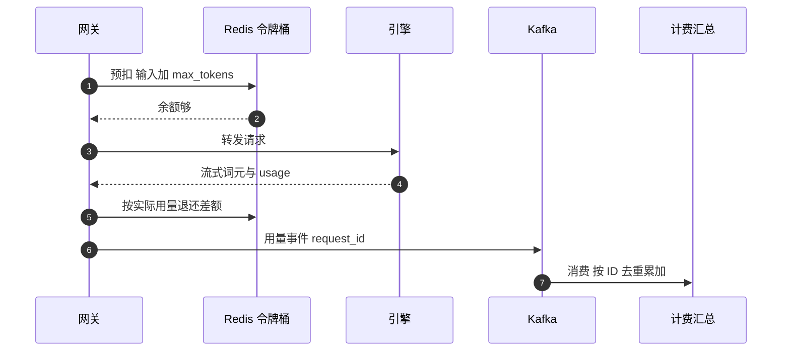

## Q
**深挖：按词元限流、计量与计费**｜完整答案 · LLM 推理服务

面试官：「每个租户有每分钟词元上限，按实际用的词元收费。请求开始时你还不知道它会生成多少词元，怎么限流？怎么保证计费不多扣、不漏扣？」

## A
**一句话。** 限流用每个租户两个令牌桶（每分钟请求数、每分钟词元数），请求开始时按"输入词元数 + `max_tokens`"**预扣**，结束时按实际用量**多退少补**；计费以引擎返回的 `usage` 为准，网关在请求结束时发出一条带 `request_id` 的用量事件，计费系统按 `request_id` 去重后累加。

**步骤。**
1. **数输入词元：** 网关用与模型相同的分词器（把文字切成词元编号的程序）数出输入词元数，比如 1,500。数不准就会限流不准，所以分词器版本跟着模型版本走。
2. **预扣：** 租户上限 100 万词元/分钟。请求 `max_tokens=1000`，预扣 1,500 + 1,000 = 2,500。Redis 里用一段 Lua 脚本原子地"补充令牌、检查、扣减"，键为 `rl:{tenant}:tpm`。余额不够就返回 429 和 `Retry-After`，以及 `x-ratelimit-remaining-tokens` 头。
3. **生成：** 请求带 `stream_options: {"include_usage": true}`，引擎在最后一块返回 `usage`：`prompt_tokens=1500`、`completion_tokens=320`。
4. **结算限流：** 实际用了 1,820，退还 680。
5. **发用量事件：** `{request_id, tenant, model, prompt_tokens, completion_tokens, cached_tokens, status, ts}` 写进 Kafka，键为 `tenant`。
6. **计费汇总：** 消费者按 `request_id` 去重（数据库唯一键或 `INSERT ... ON CONFLICT DO NOTHING`），再按租户、模型、小时累加，写入账单表。

**故障与处理。**
- **客户端中途断开：** 引擎中止时也能拿到已生成的词元数；网关在连接关闭时照样发事件，`status=cancelled`，只收实际生成的部分。
- **网关在发事件前崩溃：** 用量丢失。补救：引擎侧也记一份每个请求的用量日志，夜间对账任务把网关事件与引擎日志按 `request_id` 比对，补齐缺失的。
- **重复事件：** Kafka 至少一次投递、网关重试都会产生重复，按 `request_id` 去重使重复无害。
- **Redis 故障：** 限流"放行"还是"拒绝"要事先决定。通常降级为每个网关实例的本地限流（全局额度除以实例数），宁可短时间不太准，也不要整个服务不可用。
- **预扣太多：** 用户总写 `max_tokens=8000` 实际只用 300，会被过早限流。可以按该租户历史的平均输出长度预扣，结束时再补差额。

**为什么这样，不那样。**
- **不按请求数限流：** 一个请求的成本可以差上千倍。
- **不在请求结束后才扣：** 并发的几百个请求会同时通过检查，一起把额度用爆。
- **不同步写计费库：** 计费库慢或故障会拖累推理请求；异步事件加对账既快又准。

**数字。** 每请求 2 次 Redis 操作，500 请求/s 只有约 1,000 次/s，单个 Redis 分片足够；用量事件每条约 200 字节，按峰值算每天至多约 4,300 万条、约 9 GB。
