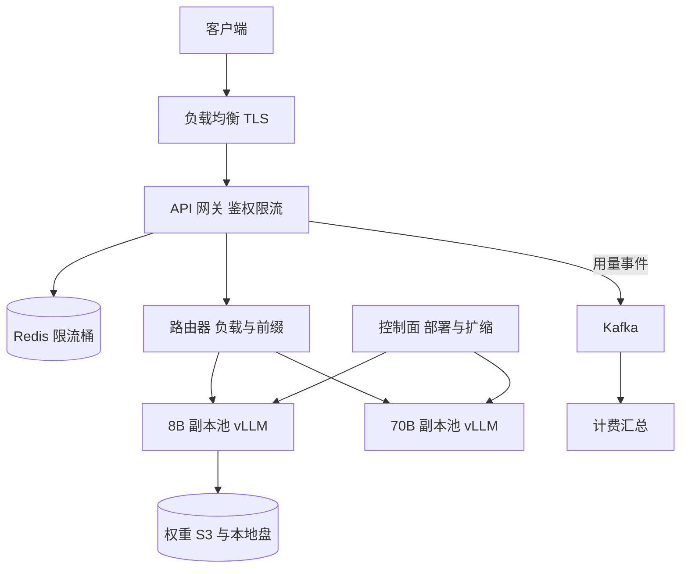

## Q
**全景**｜完整答案 · LLM 推理服务

面试官：「设计一个对外的大语言模型推理服务，接口类似 OpenAI 的 `/v1/chat/completions`：多个开源模型、流式返回、按词元计费、按租户限流。峰值每秒 500 个请求。从需求讲到深挖。」

## A
**一句话。** 无状态的 API 网关做鉴权、限流和计量；路由器按模型、负载和前缀缓存把请求送到某个推理副本；每个副本是一个 vLLM 引擎，在 GPU 上用连续批处理（每一步都可以让新请求加入、让完成的请求退出）同时服务上百路生成；词元用 SSE 流回客户端；用量事件进 Kafka 由计费系统幂等汇总。瓶颈是 GPU 上的词元吞吐和显存，不是 QPS。

**几个词。** 词元（token）约等于一个汉字或半个英文单词；首字延迟（TTFT）是从发请求到收到第一个词元的时间；字间延迟（TPOT）是之后每个词元的平均间隔；副本（replica）是一份完整加载了模型、能独立服务请求的部署。

**需求。**
- **功能（做）：** 对话补全接口，支持流式；列出模型；按租户的 API key 鉴权、限流与按词元计费。
- **功能（不做）：** 训练与微调、对话历史存储（客户端每次把历史带上来）、检索与工具执行。
- **延迟：** TTFT p95 < 1 s，TPOT p95 < 50 ms（约每秒 20 个词元以上，比人读得快）。
- **可用性：** 99.9%；单个副本或单台机器故障不影响未开始的请求。
- **计费准确：** 不多扣、不漏扣，每个请求的用量可追溯。

**规模估算（主力模型 8B，数字以压测为准）。**

|项|算式|结果|
|---|---|---|
|输入词元|500 请求/s × 1,500|75 万/s|
|输出词元|500 × 300|15 万/s|
|单请求时长|0.5 s + 300 × 40 ms|约 12.5 s|
|并发流|500 × 12.5（利特尔定律）|约 6,250 路|
|GPU 数|15 万 ÷ 每卡 2,500 输出词元/s（假设，含输入处理）|60 张，加余量约 80 张|
|每路显存|每词元约 128 KB × 1,800 词元|约 230 MB，每卡约 100 路共 24 GB|

**接口。**
- `POST /v1/chat/completions`：`model`、`messages`、`max_tokens`、`temperature`、`stream`、`stream_options.include_usage`；返回 SSE 分块，最后一块带 `usage`（`prompt_tokens`、`completion_tokens`）。
- `GET /v1/models`：可用模型列表。
- 响应头：`x-request-id`、`x-ratelimit-remaining-tokens`；错误码 400、401、429（带 `Retry-After`）、503。

**整体架构。**

**45 分钟路线。**

|时间|做什么|
|---|---|
|0–5 分|需求与不做什么；SLO 用 TTFT 和 TPOT 表达|
|5–10 分|估算到词元/s、并发流、GPU 数、每路显存|
|10–15 分|接口与流式格式、错误码|
|15–22 分|架构图：网关、路由、副本池、计量、控制面|
|22–40 分|深挖：流式与取消、调度与过载、计量限流计费、副本故障|
|40–45 分|测试与上线验证、扩展（多区域、多模型）|

**必讲深挖。**
- **流式与取消：** SSE 穿过网关与路由逐块转发；客户端断开时引擎中止生成并释放显存。
- **调度与过载：** 引擎内按显存准入，副本外按排队长度准入；超载早拒 429，不让所有人一起变慢。
- **计量、限流、计费：** 按词元的令牌桶，先按 `max_tokens` 预扣、结束后按实际多退少补；用量事件带 `request_id` 幂等入账。
- **副本故障：** 首个词元之前可安全重试，之后不重试；优雅下线排空在途请求。

**级别期望。**
- **中级：** 画出网关、路由、引擎；知道流式和批处理。
- **高级：** 用词元而不是 QPS 估容量；讲清准入、取消、按词元限流与幂等计费；给出测试与发布方案。
- **Staff：** 多模型与多租户的成本和公平、容量规划与多区域、引擎升级的发布风险、SLO 与成本的取舍。
