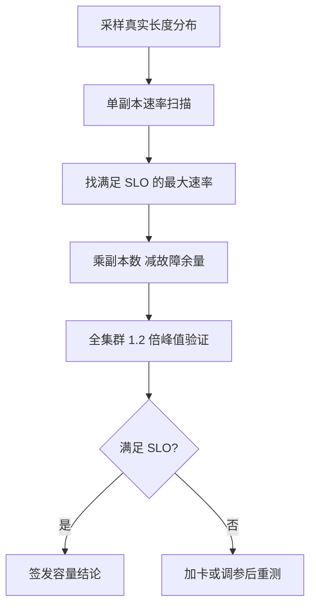

## Q
**验证容量与 SLO**｜完整答案 · LLM 推理服务

面试官：「上线前产品问你：这套集群能不能扛住峰值每秒 500 个请求，并满足首字 1 秒、字间 50 毫秒？你怎么用实验回答，而不是靠估算？」

## A
**一句话。** 先在单个副本上用真实负载找出"满足 SLO 的最大请求速率"，再用它乘以副本数并扣掉故障余量，最后在整个集群上用峰值的 1.2–1.5 倍做一次端到端验证；任何一步不满足都给出具体的差距和补救办法。

**步骤。**
1. **负载要真：** 从线上日志（或同类产品的数据）取输入和输出长度的分布，比如输入中位数 800、p99 12,000 词元，输出中位数 250、p99 2,000。用固定长度（比如全部 1,000 进 300 出）测出来的数字会过于乐观，因为长请求会拖慢同批的其他请求。
2. **按速率施压（开环）：** 用 `vllm bench serve --request-rate` 按泊松到达发请求，速率从 2/s 逐步加到 12/s。开环的意思是请求按时间表发出、不等前一个返回，这样才能看到真实的排队；按固定并发施压（闭环）会在系统变慢时自动降低压力，掩盖问题。
3. **找拐点：** 每个速率记录 TTFT p95、TPOT p95 和有效吞吐（goodput：满足 SLO 的请求每秒有多少个）。假设单副本在 8 请求/s 时 TPOT p95 刚好 48 ms，到 9 请求/s 时跳到 70 ms，那么单副本容量就是 8 请求/s。
4. **算集群：** 500 ÷ 8 ≈ 63 个副本；再按 N+2 留故障余量、按可用区故障留余量（3 个可用区时，坏一个要剩下两个能扛，即 63 × 1.5 ≈ 95）。
5. **端到端验证：** 在整个集群上以 600–750 请求/s 跑 30 分钟，包括真实的网关、路由器和限流；同时杀掉一个副本，确认 SLO 仍满足。
6. **签发：** 容量结论写清负载分布、工具版本、模型与引擎版本、每档速率的结果、拐点和结论；之后每次发布都用同一套负载重测，作为性能回归的基线。

**故障与处理。**
- **测试客户端成了瓶颈：** 单个压测进程发不出足够的流，延迟里混入了客户端的排队。先压测压测工具本身，必要时多机施压。
- **前缀缓存让数字虚高：** 压测请求的开头都一样，缓存命中率远高于线上。按线上的真实重复率构造请求。
- **路由不均：** 单副本 8 请求/s，集群却只能到 400 而不是 500，常见原因是路由把长请求集中到少数副本。看每个副本的负载分布。

**为什么这样，不那样。**
- **不只用理论估算：** 估算能给出数量级，但拐点由调度、显存和长度分布共同决定，只能实测。
- **不用平均延迟：** 平均值掩盖尾部，SLO 用 p95 或 p99。
