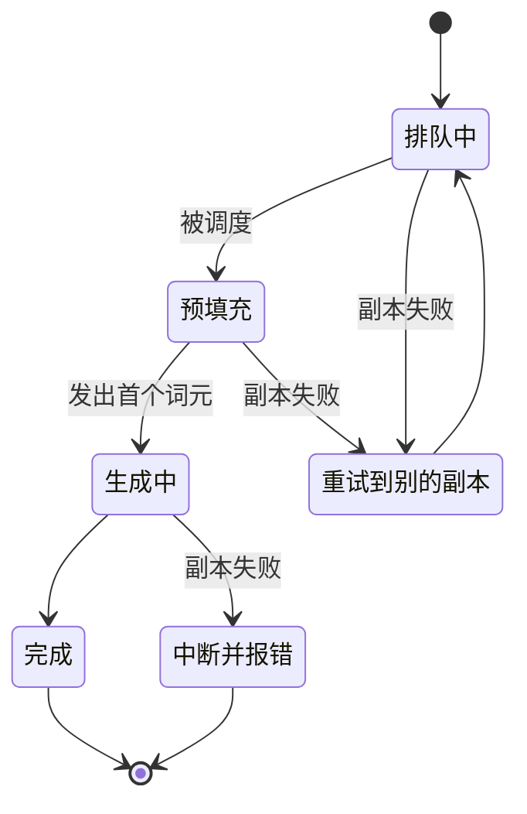

## Q
**深挖：副本故障、重试与优雅下线**｜完整答案 · LLM 推理服务

面试官：「一个推理副本在生成到一半时 GPU 出错崩了。正在流式输出的请求、还在排队的请求分别怎么办？部署新版本时怎么下线旧副本而不切断用户？」

## A
**一句话。** 以"首个词元是否已发出"为界：之前的请求由路由器透明地重试到另一个副本；之后的请求不重试，给客户端一个明确的中断错误让它自己决定。坏副本由健康检查和被动错误统计踢出；下线时先摘流量、再排空在途请求、最后退出。

**步骤。**
1. **发现故障：** 三种信号。路由器到副本的连接被重置（被动检测，最快）；副本的 `/health` 连续失败（主动检测，比如每 5 秒一次，连续 3 次失败）；GPU 层面的错误由 DCGM（NVIDIA 的 GPU 监控工具）报出 XID 错误码。
2. **摘除：** 路由器把这个副本标记为不可用，不再分配新请求；Kubernetes 的就绪探针失败也会把它从 Service 的端点里移出。
3. **首字前的请求：** 路由器还没向客户端写任何数据，就把原始请求重新发给另一个副本，客户端只感觉首字慢了一些。每个请求最多重试一次，防止一个"毒请求"（某种输入每次都让引擎崩溃）把副本一个个打垮。
4. **首字后的请求：** 已经输出了 120 个词元，换副本重新生成会得到不同的内容，不能无缝接上。网关发出一个 SSE 错误事件并关闭流，计费只算已输出的词元；客户端 SDK 可以选择从头重试。
5. **恢复：** 编排器重启 Pod 或换节点，重新加载权重，就绪后自动回到路由池。

**优雅下线（滚动发布、缩容）：**
1. Pod 收到 SIGTERM，`preStop` 钩子先让就绪检查失败，路由器停止派新请求。
2. 等待在途请求完成，上限是最长请求时长，比如 `terminationGracePeriodSeconds: 600`。
3. 超时仍未结束的请求被中断，按首字后的规则处理。

**故障与处理。**
- **毒请求：** 某个超长或特殊输入导致引擎崩溃，重试后又崩了一个副本。按输入哈希记录"导致崩溃"的次数，两次以上直接拒绝并告警。
- **假健康：** 进程活着、`/health` 返回 200，但 GPU 卡死，所有请求都超时。路由器统计每个副本的超时率，超过阈值主动摘除（被动熔断），不只依赖健康检查。
- **重试放大：** 一个副本挂掉，它的 100 路请求同时重试到其他副本，配合准入控制，超出容量的请求快速失败。

**为什么这样，不那样。**
- **不在生成中途无缝迁移：** 需要把请求的 KV 缓存（几百 MB）实时复制到另一个副本，复杂且代价大；中断后从头重试更简单。
- **不无限重试：** 毒请求和容量不足时，重试只会放大故障。

**数字。** 健康检查 5 秒 × 3 次，主动检测约 15 秒；被动检测在第一次连接失败时就生效；重新加载 8B 模型约 1–3 分钟，70B 可能 5–10 分钟，所以每个池要留至少一个副本的余量。
