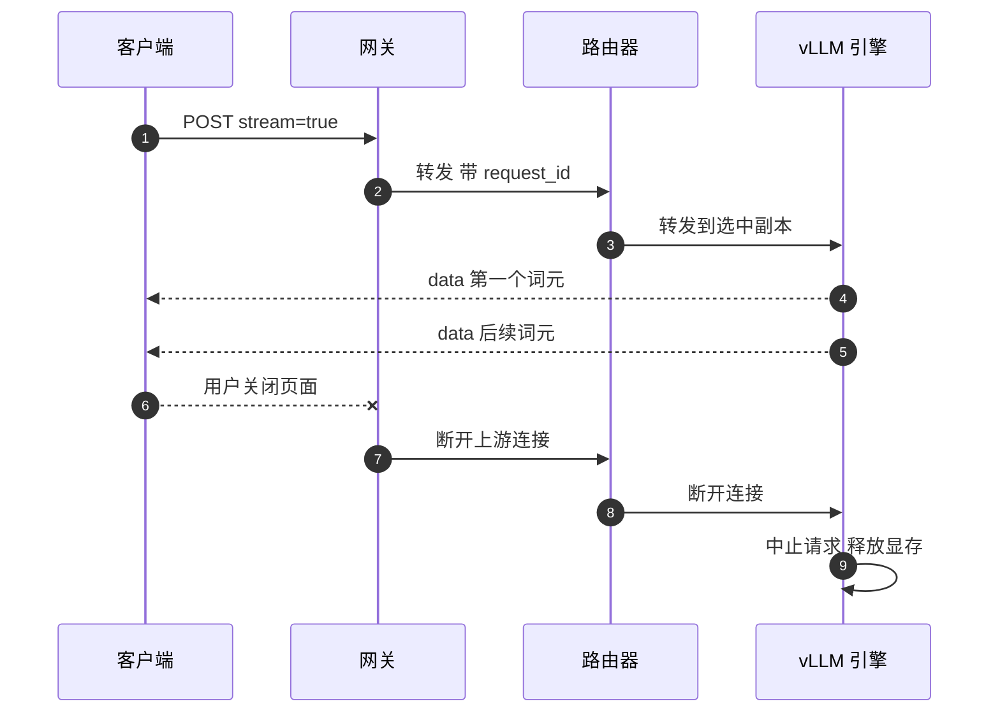

## Q
**深挖：流式返回与取消**｜完整答案 · LLM 推理服务

面试官：「一个流式请求从客户端到 GPU 再回来，具体经过什么？用户中途关掉页面，系统怎么知道、怎么停？」

## A
**一句话。** SSE 连接从客户端一路保持到引擎，每一层都逐块转发、不缓冲；任何一层发现下游连接断开，都向上游传递取消，最终由引擎把这个请求移出批次并释放它占的显存（KV 缓存：引擎为每个请求保存的、已处理文字的中间计算结果）。

**步骤。**
1. **网关收请求：** 校验 API key，按租户扣限流额度，生成 `request_id`，选定模型池后转发。HTTP/1.1 下响应头是 `Content-Type: text/event-stream`，网关必须关闭响应缓冲（Nginx 的 `proxy_buffering off`，或回 `X-Accel-Buffering: no`），否则词元会攒成一大块才到客户端。
2. **路由器选副本：** 按负载和前缀缓存打分，把请求转发到一个副本。
3. **引擎排队与生成：** vLLM 的调度器把请求放进等待队列；显存够时加入正在运行的批次，先处理全部输入（预填充），然后每一步生成一个词元。
4. **逐块回传：** 每个词元（或几个）变成一行 `data: {...}\n\n`，最后一块带 `usage`，然后是 `data: [DONE]`。
5. **取消传播：** 客户端断开 → 网关的写操作失败或收到连接关闭 → 网关关闭到路由器的连接 → 路由器关闭到引擎的连接 → vLLM 的 API 服务发现连接断开，调用引擎的中止，把请求移出批次并释放 KV 缓存块。

**故障与处理。**
- **中间层不传播取消：** 某层只是读完再转发，客户端断了它还继续从引擎读。结果 GPU 为没人看的回答一直算到 `max_tokens`。测试时专门断开客户端，检查引擎的运行中请求数在 1 秒内下降。
- **空闲超时：** 生成很慢或排队很久时，负载均衡器的空闲超时（比如 60 秒）会切断连接。排队期间定期发 SSE 注释行（以 `:` 开头）作为心跳，并把超时设到大于最长请求。
- **客户端重连：** SSE 断了以后同一个请求无法续传（引擎不保存已发出的词元以便重放），客户端只能重新发起；计费只算实际生成的词元。
- **网关重启：** 滚动重启网关时先停止接新连接，等在途流结束（设最长排空时间），否则会集中切断大量对话。

**为什么这样，不那样。**
- **不用 WebSocket：** 推理是"一问一串答"的单向流，SSE 就是普通 HTTP，现成的负载均衡、鉴权和代理都支持；WebSocket 的双向能力用不上，反而要处理连接状态。
- **不先生成完再返回：** 300 个词元要 12 秒，用户盯着空白；流式让首字 0.5 秒出现。
- **不在网关缓存整条回答：** 增加首字延迟，也让取消失效。

**数字。** 每个词元一块约 100–200 字节；6,000 路并发、每路每秒 25 块，网关每秒要转发约 15 万个小块，按连接数和每秒写次数给网关定容量，而不是按 QPS。
