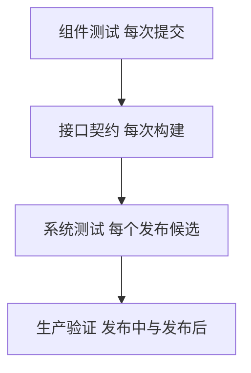

## Q
**测试**｜完整答案 · LLM 推理服务

面试官：「这个推理服务由你负责测试和发布。你的测试体系分几层？每层测什么、用什么工具、在什么时候跑？」

## A
**一句话。** 按"组件 → 接口 → 系统 → 生产"分四层：越往上越接近真实、越慢越贵，所以越往下的测试越多、越早跑；每个线上事故都沉淀成最低一层能抓住它的用例。

**第 1 层：组件（每次提交，几分钟）。**
- **网关：** 令牌桶预扣与退还的单元测试；Redis 故障时降级为本地限流；用量事件带齐字段。
- **路由器：** 给定一组副本指标，打分和选择是否正确；副本被标记不可用后不再被选中。
- **计费：** 重复事件只计一次；乱序事件的累加结果不变。

**第 2 层：接口契约（每次构建，十几分钟，小模型或单卡）。** 用 pytest 加官方 `openai` 客户端：
- **格式：** 非流式响应字段齐全；流式每块可解析、最后一块带 `usage`、以 `data: [DONE]` 结尾。
- **参数：** `max_tokens=1` 正好一个词元；`stop` 生效；`temperature=0` 两次结果一致（同一副本、同一批大小下）。
- **错误：** 无效 key 401；超长输入 400 且错误信息说明上限；超配额 429 带 `Retry-After`。
- **取消：** 发起流式请求读 5 块后断开，1 秒内引擎的运行中请求数回落。

**第 3 层：系统（每个发布候选，几小时，全尺寸集群）。**
- **性能：** `vllm bench serve` 用真实的输入输出长度分布，按请求速率扫描，找出满足 TTFT p95 < 1 s、TPOT p95 < 50 ms 的最大速率，与上一版本对比。
- **故障注入：** 杀一个副本、让 GPU 报错、让 Redis 断开、让网关重启，检查首字前重试成功、首字后有明确错误、计费对账一致。
- **长稳：** 以 70% 负载连续跑 24 小时，看显存是否慢慢涨、延迟是否漂移、有没有偶发的进程崩溃。
- **精度：** 同一批题目在新旧版本上的结果对比，确认引擎或配置改动没有改变模型行为。

**第 4 层：生产（发布中与发布后）。**
- **金丝雀：** 新版本先接 1% 流量，自动对比错误率、TTFT、TPOT、截断率。
- **合成探测：** 每分钟从每个区域发几条固定请求，检查可用性、首字延迟和返回的模型版本。
- **对账：** 每天把网关用量与引擎日志按 `request_id` 对账，差异率超过 0.01% 报警。

**收尾原则。** 每个线上事故都问"哪一层最早能抓住它"，把用例加在那一层；测试结果按发布候选归档，发布决策看证据而不是感觉。
