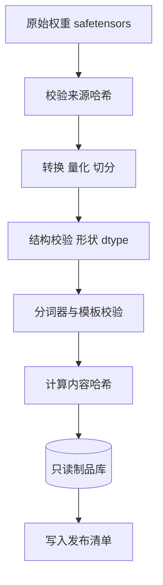

## Q
**深挖：转换、校验与不可变制品**｜完整答案 · 模型发布流水线

面试官：「拿到一个新模型的原始权重（Hugging Face 格式）。流水线第一步做什么？怎样保证测试的东西和上线的东西是同一份？」

## A
**一句话。** 第一步把原始权重转换成目标引擎和硬件需要的格式，并在转换后立刻做结构校验（哈希、张量形状、数据类型、分词器与模板一致性）；产物以内容哈希命名、写入只读的制品库，之后所有关卡和生产部署都按哈希引用同一份，绝不重新构建。

**步骤。**
1. **固定出处：** 记录原始权重的仓库、版本和每个文件的 SHA-256；下载后逐个校验，防止下到一半的文件或被篡改的文件进入流水线。
2. **转换：** 按目标生成引擎格式。例如为 TensorRT-LLM 构建引擎、为某个专用硬件编译、做 FP8 量化、按张量并行度切分权重。转换脚本、转换工具版本和参数都写进清单。
3. **结构校验：** 每个张量的名字、形状、数据类型和参数总数与模型配置一致；量化后的缩放因子没有 0、无穷大或非数值；没有遗漏的层。
4. **分词器与模板：** 分词器文件与原始仓库一致（哈希相同）；用一组固定对话渲染对话模板，结果和参考实现逐字符相同；特殊词元（开始、结束、对话轮次分隔）的编号正确。
5. **内容寻址：** 产物目录按内容哈希命名，写入后设为只读（对象存储的对象锁或只读权限）。
6. **生成清单：** 清单引用制品哈希、引擎版本、启动参数、硬件型号，作为后面所有关卡的唯一输入。

**故障与处理。**
- **转换"成功"但结果错：** 某层的权重被转置或少乘了缩放因子，引擎照样能跑，输出却是乱的。结构校验抓不到，要靠下一关的冒烟（几条固定提示的输出与参考实现比较，几分钟内发现）。
- **测试版与上线版不一致：** 测试时用的是某人本地转换的版本，上线时流水线重新转换了一次，工具版本不同。规则：只转换一次，按哈希部署；部署时校验哈希。
- **大文件传输：** 几百 GB 的制品复制到各区域可能中途失败。分块上传并逐块校验，部署时副本启动先校验清单里的哈希再加载。

**为什么这样，不那样。**
- **不在每个环境里重新转换：** 每次转换都可能因为工具或依赖不同而产出不同结果，测过的不是上线的。
- **不只校验最终精度：** 精度评测要跑几小时，结构问题几分钟就能发现，越早失败越便宜。

**数字。** 70B 模型 16 位约 140 GB，FP8 约 70 GB；结构校验加冒烟应在 30 分钟内完成，作为进入昂贵关卡前的筛子。
