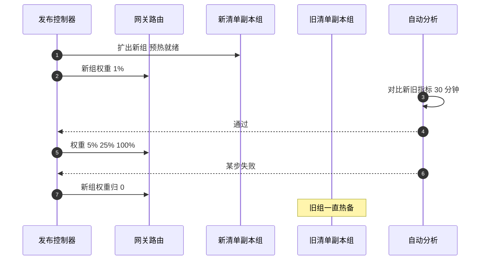

## Q
**深挖：线上放量与回滚**｜完整答案 · 模型发布流水线

面试官：「所有离线关卡都过了，新清单要上线到 40 个副本的生产池。怎么放量？自动分析看什么？发现问题时怎么在 5 分钟内回滚？」

## A
**一句话。** 新旧清单作为同一个别名下的两个副本组并存，网关按会话哈希把一小部分流量分给新组，从 1% 逐步放大；每一步由自动分析对比新旧两组的同期指标，任一指标越过阈值就把权重切回 0；旧组在新组全量后仍热备 24 小时，回滚只改路由权重。

**步骤。**
1. **扩出新组：** 按清单起新副本，等就绪；先发几条合成请求确认返回的清单版本正确。
2. **分流：** 网关按会话 ID 哈希分流，同一会话固定在同一组，避免多轮对话中途换模型。
3. **自动分析（每步 30 分钟到几小时）：** 新旧两组同时段对比：
   - **工程：** 错误率、首字和字间延迟 p95、超时率、副本崩溃次数。
   - **输出形态：** 平均输出长度、因长度上限被截断的比例、拒答比例、输出无法解析成要求格式（如 JSON）的比例。
   - **用户信号：** 重新生成率、点踩率。
   任一指标比旧组差超过阈值（如截断率高出 50%）就判失败。
4. **放量：** 通过则 1% → 5% → 25% → 100%；容量按比例从旧组挪到新组，但旧组保留足够副本。
5. **回滚：** 失败时发布控制器把新组权重设为 0，几秒生效；在途的新组会话可以继续完成，新会话全部去旧组。
6. **收尾：** 全量 24 小时后无异常，才缩掉旧组，并把别名的"上一个版本"指针更新为当前清单。

**故障与处理。**
- **流量太小看不出问题：** 某个低频模型 1% 流量每小时只有几十个请求。按"至少 N 个请求"而不是"至少 T 分钟"作为每步的停留条件，或者对低频模型直接用影子流量做比较。
- **问题只在长对话或特定语言出现：** 按切片（长度、语言、客户）分别对比，避免被总体平均掩盖。
- **回滚后又坏：** 回滚只切了权重，网关的模板配置还是新版本。回滚的单位必须是整个清单。
- **容量不够两组并存：** GPU 紧张时没法让两组都满配。旧组保留能扛 50% 流量的副本，回滚时先限流低优先级流量，再扩旧组。

**为什么这样，不那样。**
- **不直接滚动替换：** 滚动更新会把旧副本逐个替换掉，出问题时旧版本已经不在了，回滚要重新加载权重，几分钟到十几分钟。
- **不按请求随机分流：** 同一用户的多轮对话在新旧模型之间跳，体验差且无法归因。

**数字。** 路由权重切换几秒；从发现到回滚完成的目标 ≤ 5 分钟，其中自动分析的检测周期是主要部分（比如每 1 分钟评估一次、连续 3 次失败才回滚，约 3 分钟）。
