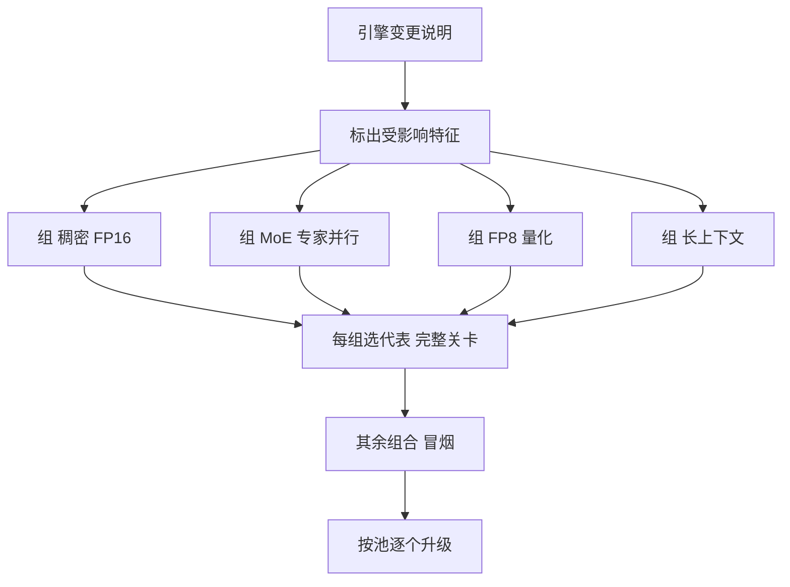

## Q
**深挖：引擎升级与兼容矩阵**｜完整答案 · 模型发布流水线

面试官：「推理引擎每两周升级一次版本，平台上有 15 个模型、每个有 2–3 种并行和量化配置、跑在两种 GPU 上。一次引擎升级可能影响全部组合，不可能每次全测。你怎么选测什么？怎么上线？」

## A
**一句话。** 把（模型 × 配置 × 硬件）列成矩阵，按"风险特征"分组，每组选一个代表组合跑完整关卡、其余组合只跑冒烟；引擎升级和模型发布分开走、互不捆绑；生产上按池逐个升级，先升风险最低、流量最小的池。

**矩阵有多大：** 15 个模型 × 平均 2.5 种配置 × 2 种硬件 ≈ 75 个组合。每个组合完整关卡约半天 GPU 机时，全测要几十个 GPU 天，两周一次不现实。

**步骤。**
1. **读变更：** 引擎新版本改了哪些模块：注意力的计算程序、量化的计算程序、调度器、混合专家（MoE：模型由很多"专家"子网络组成、每个词元只用其中几个）的通信。每个模块对应矩阵里的一类特征。
2. **分组：** 按会影响结果的特征分组：注意力类型、量化格式、并行方式、是否 MoE、最大上下文长度、硬件型号。
3. **选代表：** 每组至少一个组合跑完整的精度和性能关卡；选流量最大或历史上最容易出问题的那个。
4. **全覆盖冒烟：** 所有 75 个组合都跑冒烟：能启动、几条固定提示的输出与参考接近、单档并发的吞吐不低于基线太多。几分钟一个，可以并行。
5. **兼容性记录：** 结果写进兼容矩阵（哪个引擎版本对哪个组合是"已验证 / 仅冒烟 / 已知问题"），部署系统拒绝部署"已知问题"的组合。
6. **生产升级：** 一个池一个池地升级，用和模型发布一样的金丝雀与回滚；先升内部流量的池，最后升最大的客户池。

**故障与处理。**
- **漏测组合出问题：** 某个只跑了冒烟的组合在生产上延迟变差。它进入下一次的"代表"名单；同时把冒烟里的性能检查加严。
- **引擎升级和模型发布撞车：** 新模型同时依赖新引擎，出问题分不清是谁的。规则：新引擎先在现有模型上稳定一周，新模型再基于它发布；必须捆绑时，分别准备两个回滚点。
- **默认参数变了：** 新版本引擎的某个默认值改了（比如调度或缓存相关的默认），所有模型的行为都变。清单里把关键参数显式写死，不依赖默认值。

**为什么这样，不那样。**
- **不全量测：** 成本太高，发布周期会被拖到一个月。
- **不只测一个模型：** 一个稠密模型过了，不代表 MoE 或 FP8 的组合也过，因为它们走的是不同的代码路径。

**数字。** 75 个组合冒烟各约 10 分钟，并行 20 路约 40 分钟；4–6 个代表组合完整关卡约 2–3 天 GPU 机时，可以在一到两天内跑完。
