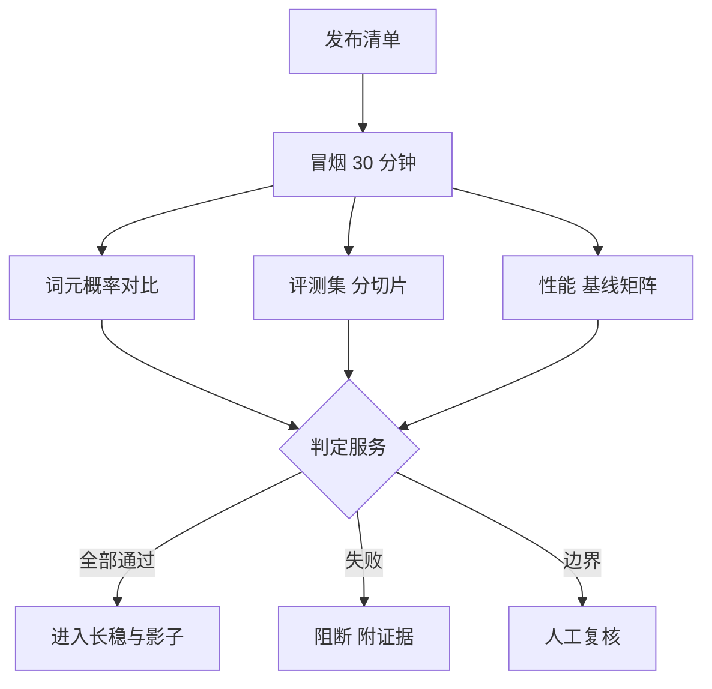

## Q
**深挖：精度与性能关卡的编排**｜完整答案 · 模型发布流水线

面试官：「精度评测要跑几千道题，性能基准要扫十几种配置，都要占 GPU。你怎么编排这些关卡、定阈值、自动判定，而不是每次让人看图拍板？」

## A
**一句话。** 关卡编排成一个有向无环图（DAG）：便宜的先跑、昂贵的并行跑；每个关卡把结果写成结构化证据（指标、阈值、基线、样本量、版本），由一个判定服务按规则给出通过、失败或"需人工"；阈值来自重复运行测得的噪声，而不是拍脑袋。

**步骤。**
1. **调度：** 工作流引擎（Argo Workflows 或 Temporal）按 DAG 启动任务；每个任务申请对应型号的 GPU，结果写入证据库。冒烟失败则后面全部不跑。
2. **精度关卡（两层）：**
   - **与参考实现对比：** 同一批输入，比较新清单与参考实现在每个位置给出的词元概率，看最可能词元的一致率和两个分布的差距（KL 散度）。几分钟就能抓到量化或转换错误。
   - **评测集：** 用固定版本的评测集，按任务类型和长度分切片；新旧版本在同一批题上做配对比较，差异的置信区间下界低于阈值才算退化。
3. **性能关卡：** 按（模型，并行配置，输入输出长度，并发档位）组成的矩阵，用 `vllm bench serve` 跑；每个格子和"该格子的历史基线"比较首字延迟、字间延迟和吞吐。
4. **阈值：** 每个指标重复运行 5–10 次测得标准差，阈值设为基线减 2–3 个标准差；同时和最初签发的版本比，防止每次只慢一点、累计慢很多。
5. **判定：** 判定服务读取证据：硬阈值失败直接阻断；落在边界区（比如精度下降但不显著）标为"需人工"，由模型负责人签字决定，豁免记录在案并设到期时间。
6. **报告：** 自动生成一页结论：每个关卡的结果、与基线的差、链接到原始数据。

**故障与处理。**
- **GPU 资源不够：** 十几个关卡同时排队，发布被拖几天。给发布关卡预留专用的 GPU 配额，并按优先级调度（紧急修复优先）。
- **基础设施失败与产品失败混在一起：** 机器掉线导致任务失败，被误认为模型有问题。任务失败要分类（环境、测试本身、产品），环境失败自动重试一次，不计入判定。
- **基线过期：** 硬件驱动升级后所有性能数字整体变化。基线按（硬件，驱动版本）分组，驱动升级单独建立新基线。

**为什么这样，不那样。**
- **不串行跑所有关卡：** 精度和性能互不依赖，并行能把一天缩到几小时。
- **不让人看图决定：** 人的判断不一致也不可追溯；规则化后人只处理边界情况。
- **不只用总分：** 总分会掩盖某个切片的明显退化。

**数字。** 冒烟 30 分钟内；概率对比约 10 分钟；评测集几小时；性能矩阵 20–40 个格子、每格 5–10 分钟，约半天，可按格子并行。
