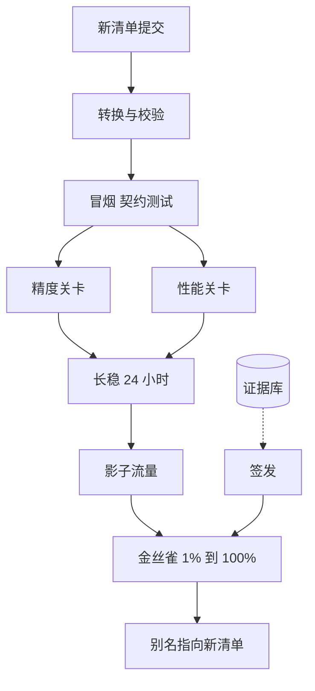

## Q
**全景**｜完整答案 · 模型发布流水线

面试官：「推理平台每月要上线几个新模型，还要每两周升级一次推理引擎。设计一条发布流水线：从拿到权重到全量上线，经过哪些关卡、谁签发、失败怎么回滚。」

## A
**一句话。** 发布单位是一个不可变的"发布清单"（权重、分词器、对话模板、量化方案、引擎版本与参数、硬件配置，全部带哈希）；流水线把清单依次送过 转换 → 冒烟 → 精度 → 性能 → 长稳 → 影子 → 金丝雀 这几道关卡，每道关卡产出机器可读的证据，自动判定通过或阻断；上线与回滚都只是切换别名指向哪个清单。

**几个词。** 权重是模型学到的参数；分词器把文字切成词元编号；对话模板把多轮对话拼成模型训练时见过的格式；量化是把每个参数用更少的位存，换速度和显存。

**需求。**
- **功能：** 新模型、新权重版本、新引擎版本、新量化方案、新硬件配置，都走同一条流水线；支持只改其中一项。
- **质量：** 精度不低于参考实现超过阈值；性能不低于基线超过阈值；所有证据可追溯。
- **速度：** 常规发布从提交到可全量 ≤ 3 天；紧急修复走快速通道，≤ 6 小时。
- **回滚：** 线上回滚 ≤ 5 分钟。

**整体架构。**

**45 分钟路线。**

|时间|做什么|
|---|---|
|0–5 分|发布对象有哪些：模型、引擎、量化、硬件，各自风险|
|5–10 分|发布清单与不可变制品|
|10–20 分|关卡流水线：顺序、并行、各关卡输入输出|
|20–38 分|深挖：转换与制品、精度与性能关卡编排、金丝雀与回滚、引擎升级矩阵|
|38–45 分|签发与豁免、怎么测流水线本身|

**必讲深挖。**
- **转换与制品：** 从原始权重转成引擎格式，校验哈希、形状、分词器与模板；一次构建、处处使用。
- **关卡编排：** 精度（与参考实现逐位置比较词元概率、评测集分切片）和性能（按模型和配置的基线矩阵）并行跑，统一由证据决定。
- **金丝雀与回滚：** 按流量逐步放大并自动分析；旧清单热备；回滚切别名。
- **引擎升级矩阵：** 一次引擎升级影响所有模型，按（模型 × 配置 × 硬件）矩阵挑代表组合验证。

**级别期望。**
- **中级：** 能列出测试步骤和金丝雀。
- **高级：** 清单化与不可变制品、关卡的阈值与噪声、证据驱动的自动判定、回滚演练。
- **Staff：** 组织层面的签发与豁免流程、引擎与模型发布节奏解耦、缩短发布周期的投入产出。
