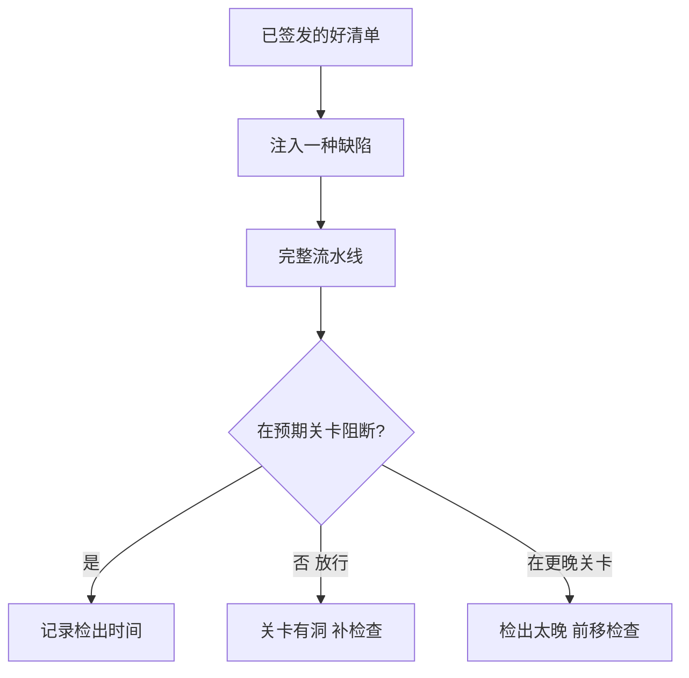

## Q
**测试流水线本身**｜完整答案 · 模型发布流水线

面试官：「你的流水线每次都显示全绿。你怎么证明它真的能拦住坏版本，而不是什么都放行？」

## A
**一句话。** 用"故意做坏的版本"测试关卡：定期往流水线里注入已知缺陷（错的模板、坏的量化、慢的配置），统计每类缺陷是否在预期的关卡被拦下、用了多久；拦不住就是关卡有洞。这和用变异测试检验单元测试是同一个思路。

**缺陷目录（每类对应一个预期拦截关卡）：**

|注入的缺陷|应在哪一关被拦|
|---|---|
|对话模板少一个结束标记|冒烟：输出不停止|
|某层量化缩放因子乘错 2 倍|词元概率对比|
|分词器换成相近但不同的版本|结构校验或概率对比|
|长上下文的位置编码配置错|评测集的长文切片|
|并发上限设成原来的一半|性能矩阵|
|引擎内存缓慢泄漏|24 小时长稳|
|新版本拒答率翻倍|金丝雀自动分析|

**步骤。**
1. **建缺陷库：** 每次线上事故都变成一种可注入的缺陷，加进目录。
2. **定期演练：** 每月（或每次修改关卡代码后）挑几种缺陷，基于一个已签发的好清单做出"坏版本"，走完整流水线；生产阶段的缺陷在预发环境的金丝雀上演练。
3. **度量：** 检出率（被拦下的比例）、在预期关卡被拦的比例、平均检出时间。
4. **修洞：** 放行的缺陷说明缺检查；在更晚关卡才被拦的，说明可以把检查前移到更便宜的关卡。

**也要测"不误杀"：** 用同一个好清单重复跑 10 次流水线，统计误报（好版本被阻断）的次数。误报多了，大家就会习惯性豁免，关卡形同虚设。目标：误报率低于 5%，且每次误报都有根因分析。

**其他检查：**
- **证据完整性：** 每个签发的清单都必须有全部关卡的证据记录；缺一项的不能被部署系统接受。
- **豁免审计：** 豁免必须有负责人、理由和到期时间；每季度统计豁免数量和到期未处理的条目。
- **回滚演练：** 每月在预发环境实际回滚一次，计时，确认 5 分钟目标仍然成立。

**为什么这样，不那样。**
- **不只看"全绿"：** 全绿可能是因为关卡在测错的东西、阈值太松、或测试被静默跳过。只有拦住已知的坏版本，才证明它能拦住未知的。
