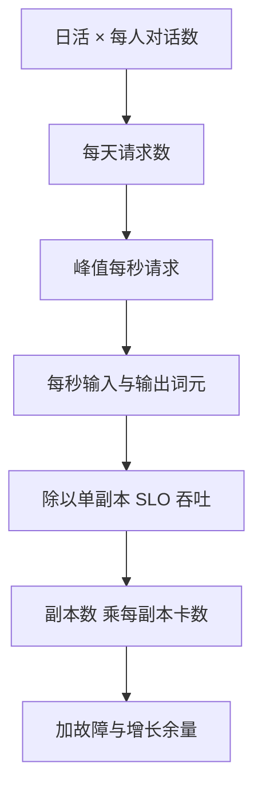

## Q
**深挖：从业务量到 GPU 数的容量模型**｜完整答案 · 多区域部署与容量规划

面试官：「产品给你的是"日活 1,000 万，人均每天 4 次对话"。怎么一步步换算成每个区域要多少张卡？哪些假设最容易错？」

## A
**一句话。** 业务量 → 每秒请求（按峰值）→ 每秒输入与输出词元 → 除以单副本在 SLO 内的吞吐得到副本数 → 乘每副本卡数；每一步的假设都写下来，并用线上数据定期校准；最容易错的是峰均比、输出长度和单副本吞吐。

**手算。**
1. **每天请求：** 1,000 万 × 4 = 4,000 万次。
2. **平均每秒：** 4,000 万 ÷ 86,400 ≈ 463 次/s。
3. **峰值：** 白天集中，峰均比取 2.5，约 1,160 次/s。
4. **词元：** 每次输入平均 2,000 词元（多轮对话把历史一起带上，所以比单句长得多），输出平均 260 词元。输入约 230 万词元/s，输出约 30 万词元/s。
5. **单副本吞吐：** 压测得到 70B 的 4 卡副本，在这个输入输出比例下、满足首字和字间延迟目标时，约 4,000 输出词元/s（数字为假设，必须用自己的负载实测）。
6. **副本与卡：** 30 万 ÷ 4,000 = 75 个副本，300 张卡。
7. **余量：** 故障余量（失去最大区域）约 +30%，每区 N+1，半年增长 +20%：300 × 1.3 + 12 ≈ 400，再 × 1.2，约 480 张卡。

**最容易错的假设。**
- **输出长度：** 估成 100 和实际 400，卡数差 4 倍。用线上分布或同类产品数据，不要用"一句话的长度"。
- **多轮输入膨胀：** 第 10 轮对话的输入包含前 9 轮，输入词元随轮数增长；前缀缓存能省掉重复部分的计算，但命中率要实测。
- **单副本吞吐：** 用固定短输入压测会高估 2–3 倍；必须用真实的长度分布、开环施压，取满足 SLO 的点，而不是最大吞吐点。
- **峰均比：** 新产品或营销活动时的峰值可能是平时的 5 倍以上。
- **时区错峰：** 三个区域的高峰不同时出现，全局峰值小于各区峰值之和。按区域各自的峰值分配，但跨区溢出可以利用错峰，减少总余量。

**采购节奏。** GPU 交付常以月计，容量规划按季度做：每月用实际流量校准模型，预测未来 3–6 个月的需求，预留实例覆盖稳定的基线，按需或短期合约覆盖增长和突发。

**数字。** 每 1 万输出词元/s 约需 2.5 个副本（10 张卡）；输出长度每增加 100 词元，本例需要多约 29 个副本（1,160 × 100 ÷ 4,000）。
