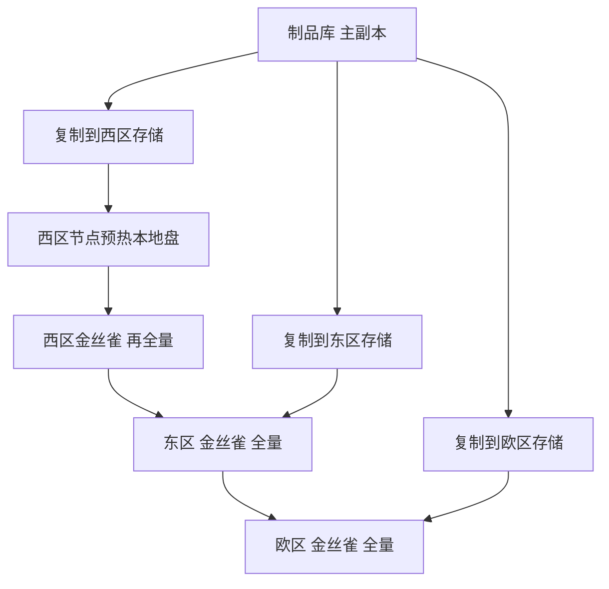

## Q
**深挖：跨区域发布与权重分发**｜完整答案 · 多区域部署与容量规划

面试官：「新模型版本的权重 140 GB，要发布到三个区域、几百台机器。怎么分发？按什么顺序发布？发布期间不同区域跑着不同版本，会有什么问题？」

## A
**一句话。** 权重只构建一次，复制到每个区域自己的对象存储（并校验哈希），区域内再预热到节点本地盘；发布按"最小风险区域 → 其他区域"逐个进行，每个区域内部再走金丝雀；发布期间允许区域间版本不同，但同一会话通过区域粘住、溢出时只溢到同版本区域。

**步骤。**
1. **跨区复制：** 制品发布后立即复制到三个区域的对象存储，按分块上传、逐块校验；完成后在清单里登记"该区域已就绪"。140 GB 跨区复制按 1 GB/s 约 2–3 分钟，实际受带宽和配额影响可能更久，所以复制要早于发布开始。
2. **区域内预热：** 在发布前把权重预拉到将要承载新版本的节点的本地 NVMe 上，后面替换副本时不再从对象存储下载，避免几十个副本同时下载打满带宽。
3. **发布顺序：** 先选流量最小、非高峰时段的区域（比如此时是夜间的区域）；该区域金丝雀到全量并观察数小时后，再发下一个区域。大区域最后发。
4. **区域内金丝雀：** 每个区域内部 1% → 5% → 25% → 100%，按新旧版本的同时段对比自动判定。
5. **全局状态：** 控制面记录每个区域当前跑哪个清单、旧清单是否仍热备，作为回滚依据。

**版本不一致带来的问题与处理。**
- **溢出跨版本：** 东区还是旧版本，西区已是新版本，东区溢出的请求在西区由新版本回答，同一用户前后两轮由不同模型回答。处理：溢出时优先送往同版本的区域；不得不跨版本时接受，但在日志里标明版本，避免误判质量问题。
- **对比失真：** 区域间用户群不同，直接比较"西区新版本 vs 东区旧版本"会把地域差异当成模型差异。每个区域内部做新旧对比才可靠。
- **客户端依赖版本行为：** 输出格式有变化的发布，要等所有区域都发完再宣布新特性，或者在接口上用不同的模型名区分。

**故障与处理。**
- **某区域复制失败：** 这个区域暂不发布，其他区域可以继续；控制面阻止在"制品未就绪"的区域启动新版本副本。
- **一个区域发布后出问题：** 只在该区域回滚，其他区域停止推进；回滚依赖该区域旧版本的热备副本。
- **合规：** 欧区的制品和日志只存在欧区；跨区复制只复制模型制品，不复制用户数据。

**为什么这样，不那样。**
- **不同时发三个区域：** 出问题时全球都受影响，失去"还有一个区域是好的"这个最后保障。
- **不让每个区域从主副本直接拉：** 跨区拉取慢且贵，几百个节点同时拉会打满跨区带宽。

**数字。** 三个区域逐个发布、每区观察 4–8 小时，全球发完约 1–2 天；紧急修复可以压缩到每区 1 小时。
