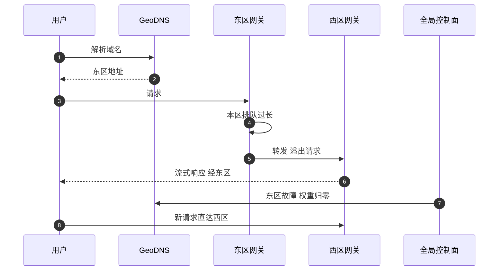

## Q
**深挖：全局路由、溢出与区域切流**｜完整答案 · 多区域部署与容量规划

面试官：「东区的 GPU 已经满了，但西区还有空闲；某天东区整个故障。请求怎么在区域之间流动？谁检测、谁决定、多久生效？欧洲用户的数据能不能被送到美国？」

## A
**一句话。** 三层：GeoDNS（或任播）按位置把用户送到最近的区域；每个区域入口网关在本区排队超过阈值时，把可溢出的请求转发到有余量的同合规区域；全局控制面根据各区健康和容量调整 DNS 权重，区域失效时把它的权重降为 0，并按事先定好的顺序降级可丢弃流量。

**步骤。**
1. **就近：** GeoDNS 按用户 IP 返回最近区域的地址，TTL 设 30–60 秒，切流时客户端能较快拿到新地址。任播（同一个 IP 在多个区域宣告，由网络路由选最近的）切换更快，但需要自有网络或云厂商的全局负载均衡。
2. **区域内优先：** 请求先在本区的副本池里排队和调度。
3. **溢出：** 本区入口网关看到本区预计等待超过阈值（比如 1 秒），就把新请求转发到同一合规域内有余量的区域。跨区多一次 60–80 ms 的往返，对首字延迟可以接受，比在本区排队几秒好。溢出要按目标区域的实时余量限速，防止把对方也压垮。
4. **健康检测：** 全局控制面从多个外部位置每 10 秒探测每个区域的入口（合成请求，检查能否在时限内返回首个词元），并读取各区的容量指标。
5. **切流：** 一个区域连续多次探测失败（比如 3 次，约 30 秒），控制面把它的 DNS 权重设为 0；客户端在 TTL 过期后解析到其他区域。已经在进行的流式请求会中断，客户端重试时被送到新区域。
6. **降级顺序：** 剩余区域容量不够时，按事先定好的顺序释放容量：先暂停批量和离线评测任务 → 再对免费层限流 → 最后对付费交互流量的新会话排队。

**合规边界。**
- **欧洲数据只在欧洲处理：** 欧区是单独的合规域。欧区的溢出只能去其他欧洲区域；欧区整体失效时，欧洲用户的请求返回明确的错误，而不是悄悄送到美国。
- **路由带标签：** 每个租户带"允许的区域集合"，入口网关和控制面都按它过滤目标。

**故障与处理。**
- **误判区域故障：** 探测点自身的网络问题让健康区域被切走。要求多个探测点里多数失败才切流。
- **切流引发连锁：** 东区 45% 的流量瞬间压到西区和欧区。依赖事先留好的故障余量和降级顺序；控制面把切流分成几步、每步观察。
- **缓存冷：** 切到新区域后前缀缓存全部未命中，首字延迟短时升高，属正常，但容量规划要考虑这段时间吞吐下降。
- **恢复后回切：** 故障区域恢复后逐步把权重加回去，先 10%，确认稳定再加，避免它刚恢复又被压垮。

**为什么这样，不那样。**
- **不做跨区域会话粘性：** 推理无状态（历史在请求里），没必要粘住；粘性只会让切流变慢。
- **不只靠 DNS：** DNS 切换受客户端缓存影响，分钟级生效；区域入口的溢出是秒级的。
