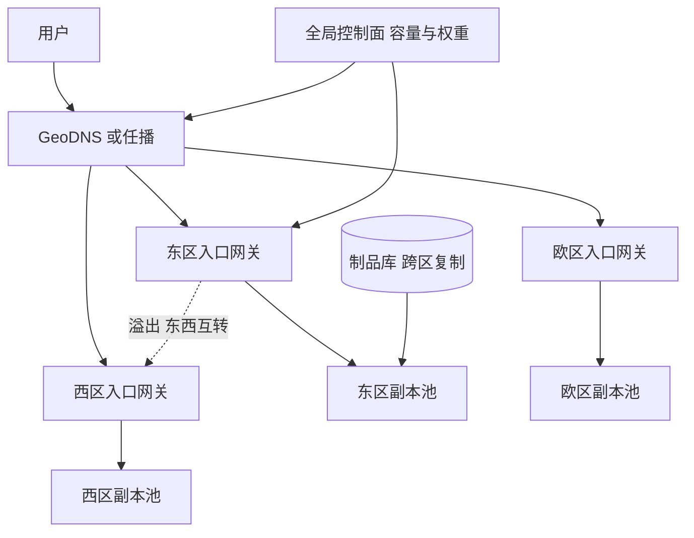

## Q
**全景**｜完整答案 · 多区域部署与容量规划

面试官：「一个 70B 模型的聊天服务要在北美东、北美西和欧洲三个区域部署。峰值每秒 30 万个输出词元。要估算需要多少 GPU、怎样在区域间调度流量、一个区域整个故障时怎么办。」

## A
**一句话。** 用"每秒输出词元 ÷ 单副本在 SLO 内的输出词元吞吐"算副本数，按各区域峰值分配，再按"失去最大一个区域后剩余区域要扛住多少"加故障余量，用可丢弃流量（批量、免费层）抵掉一部分；全局流量由 GeoDNS 或任播把用户送到最近的区域，区域入口按容量把溢出的流量转到别的区域；推理是无状态的（对话历史在每个请求里），所以切流只损失前缀缓存，不损失数据。

**几个词。** 副本是一份完整加载了模型的部署（70B 约 4 张 80 GB 显存的卡）；SLO 是延迟目标，如首字 p95 < 1 s、字间 p95 < 50 ms；可用区（AZ）是一个区域内相互独立的机房。

**需求。**
- **延迟：** 用户就近访问，网络往返 < 100 ms；首字和字间延迟同上。
- **可用性：** 99.95%；任一区域整体失效时，交互流量仍可服务，批量流量可以暂停。
- **合规：** 欧洲用户的数据只在欧洲区域处理。
- **成本：** GPU 是最大开销，余量要算出来，不能拍脑袋。

**容量估算（数字为假设，以压测为准）。**

|项|算式|结果|
|---|---|---|
|单副本吞吐|压测：4 卡副本在 SLO 内约 4,000 输出词元/s|每卡约 1,000|
|全局峰值副本|30 万 ÷ 4,000|75 个，300 张卡|
|区域分配|东 45%、西 25%、欧 30%|34、19、22 个|
|故障余量|失去东区，补 34 个中的 70%（30% 可丢弃）|约 24 个，分给西区和欧区|
|合计|75 + 24 + 每区 N+1|约 102 个，约 410 张卡|

**整体架构。**

**45 分钟路线。**

|时间|做什么|
|---|---|
|0–5 分|需求：区域、合规、可用性、SLO|
|5–15 分|容量估算：词元 → 副本 → 卡，按区域分配，故障余量|
|15–22 分|架构：全局调度、区域入口、溢出、控制面|
|22–40 分|深挖：容量模型、全局路由与切流、跨区发布与权重分发|
|40–45 分|故障演练与容量验证|

**必讲深挖。**
- **容量模型：** 从业务量到词元、到副本、到卡；峰值、时区错峰、余量、采购节奏。
- **全局路由与切流：** 就近、按容量溢出、区域失效时的切流与降级顺序、合规边界。
- **跨区发布：** 权重复制、按区域逐个发布、版本一致性。

**级别期望。**
- **中级：** 能算出卡数，知道多区域和就近路由。
- **高级：** 故障余量与可丢弃流量的取舍、溢出与切流机制、合规边界、跨区发布顺序。
- **Staff：** 预留与按需的采购组合、时区错峰的成本账、容量规划的周期与预测误差。
