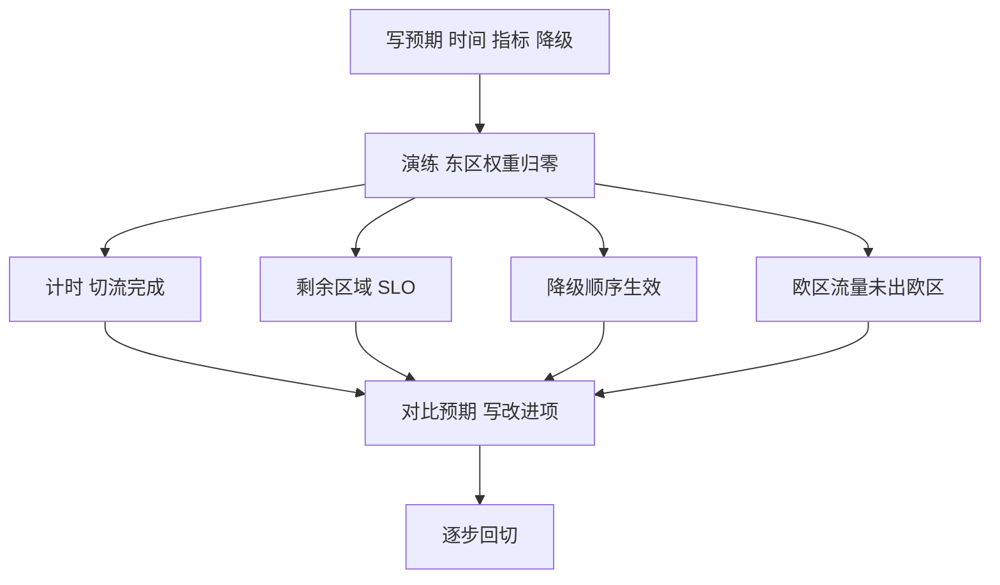

## Q
**测试与演练**｜完整答案 · 多区域部署与容量规划

面试官：「容量和切流方案写在文档里谁都会。你怎么证明一个区域真的挂了以后，剩下的区域扛得住、切流在几分钟内完成、合规边界不会被破？」

## A
**一句话。** 用定期的区域故障演练（game day）在生产或等规模的预发环境里真的切走一个区域，按事先写好的预期逐项计时和验证；容量模型用每月的实际流量校准；合规边界用自动化测试持续验证。

**1. 区域故障演练（每季度）。**
- **事先写预期：** 切流在 3 分钟内完成；剩余区域首字延迟 p95 < 1.5 s（允许变差但有上限）；批量任务在 1 分钟内暂停；免费层被限流的比例不超过 X；没有欧洲请求被送出欧区。
- **执行：** 在低峰时段把东区的 DNS 权重和入口都关掉（或在预发环境模拟东区全部副本失效）。
- **测量：** 从关闭到其他区域接住流量的时间、每分钟的错误率和 429 比例、剩余区域的 GPU 排队和 KV 占用、溢出流量是否超过对方余量。
- **回切：** 按 10% → 50% → 100% 加回东区，观察冷缓存期间的延迟。
- **改进项：** 每个不符合预期的项目都有负责人和期限。

**2. 容量模型校准（每月）。**
- **对比：** 模型预测的每区副本数 vs 实际高峰时使用的副本数和 SLO 达成率。
- **校准：** 输出长度、输入长度、峰均比、单副本吞吐四个参数用上月数据更新；误差超过 20% 的参数要查原因（产品变化、新客户、引擎升级）。
- **压测复核：** 每次引擎或模型版本变化后，重测单副本在 SLO 内的吞吐，因为它直接决定卡数。

**3. 溢出与合规的自动化测试（持续）。**
- **溢出：** 在预发环境把一个区域的容量人为调小，发流量直到溢出，断言溢出只去同合规域、且按对方余量限速。
- **合规：** 用带欧区标签的测试租户从各地发请求，断言日志里所有处理节点都在欧区；欧区全部不可用时返回明确错误。
- **探测器：** 从多个外部位置每分钟对每个区域做合成请求，同时验证探测器自身：故意让一个探测点断网，确认不会误判区域故障。

**收尾。** 演练结果和容量校准都形成可追溯的记录；没有演练过的切流方案，只能当作假设。
