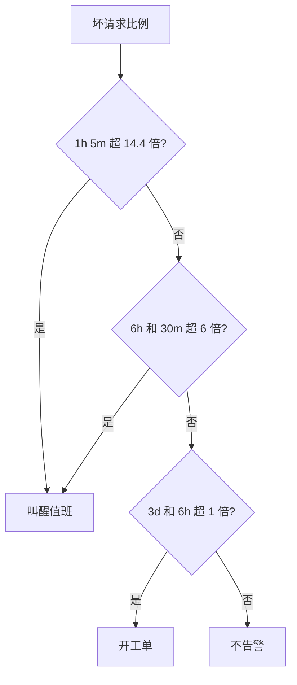

## Q
**深挖：基于错误预算的告警**｜完整答案 · LLM 服务的可观测性与成本

面试官：「现在的告警是"首字 p95 超过 1 秒持续 5 分钟就叫醒值班"，每周半夜响好几次，大部分时候自己就好了。怎么改？给出具体规则。」

## A
**一句话。** 先定义 SLO 和"坏请求"，再按错误预算的消耗速度（burn rate）告警：短时间内烧得很快才叫醒人，慢慢烧的开工单；短窗口和长窗口同时超阈值才触发，既能快速发现大故障，又能忽略自行恢复的小抖动。

**定义。**
- **好请求：** 状态码成功、首字 < 1 s，且没有因平台原因中断。
- **SLO：** 30 天内 99.9% 的请求是好请求，错误预算 = 0.1%。
- **消耗速度：** 当前坏请求比例 ÷ 0.1%。坏请求比例为 1.44% 时，消耗速度是 14.4，意思是按这个速度，30 天的预算约 2 天就烧完。



**规则（多窗口、多消耗速度，常见的一组取值）。**
- **叫醒：** 1 小时窗口和 5 分钟窗口的消耗速度都大于 14.4（这 1 小时已烧掉月预算的约 2%）。
- **叫醒：** 6 小时窗口和 30 分钟窗口都大于 6（烧掉约 5%）。
- **工单：** 3 天窗口和 6 小时窗口都大于 1（烧掉约 10%）。
- 短窗口的作用：故障恢复后，短窗口很快回落，告警随之解除，不会因为长窗口里还残留着坏数据而一直响。

**PromQL 写法示意。**
```
(sum(rate(gw_bad_requests_total[1h])) / sum(rate(gw_requests_total[1h])) > 14.4 * 0.001)
and
(sum(rate(gw_bad_requests_total[5m])) / sum(rate(gw_requests_total[5m])) > 14.4 * 0.001)
```

**按模型和优先级分开：** 每个模型池各自一套 SLO 和告警，否则一个小模型全挂了，在全平台的比例里可能只占 1%，永远不触发。

**不走 SLO 的告警（直接是原因）：**
- **GPU XID 错误：** 自动把该副本摘出路由池并开工单，不叫醒人。
- **KV 占用持续 > 95% 且有抢占：** 容量工单，提示扩容或调参。
- **成本异常：** 某租户的日用量是过去 7 天均值的 5 倍以上，通知租户负责人。
- **监控本身失效：** 某个区域的指标停止上报 5 分钟，叫醒人，因为此时其他告警都不会响。

**为什么这样，不那样。**
- **不用"p95 超阈值持续 N 分钟"：** 不考虑流量大小和持续影响，半夜几十个请求的小波动也会叫醒人。
- **不只看平均：** 平均延迟正常时，长尾用户可能已经大面积超时。
