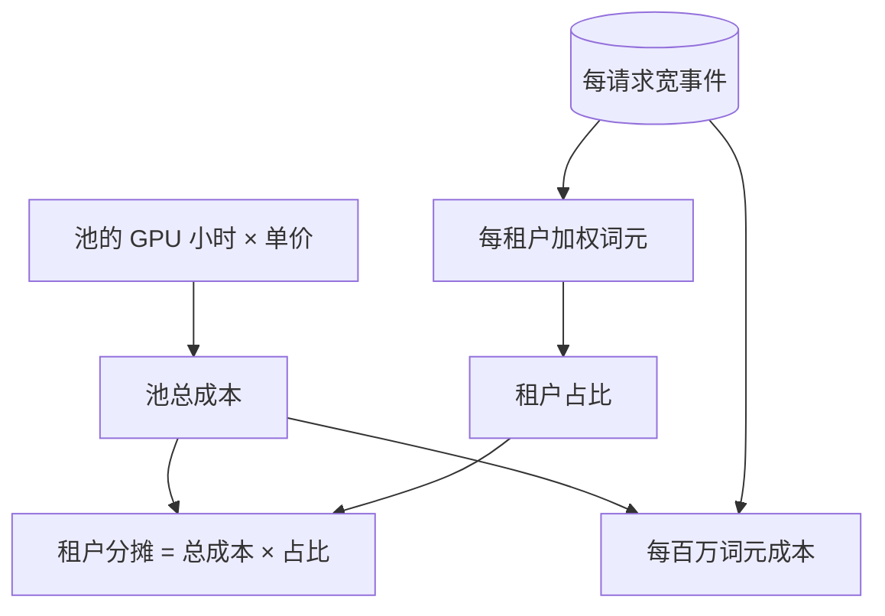

## Q
**深挖：每百万词元成本与按租户分摊**｜完整答案 · LLM 服务的可观测性与成本

面试官：「财务问：我们服务 8B 模型，每百万个输出词元的成本是多少？300 个租户共用 GPU，每个租户该分摊多少？手算给我看。」

## A
**一句话。** 每百万词元成本 = GPU 每小时费用 ÷ 每小时实际产出的词元数 × 100 万；关键在分母要用"实际产出"，即乘上真实利用率，而不是压测时的峰值吞吐；租户分摊按"加权词元"计：输入词元和输出词元按它们各自消耗的 GPU 时间加权，再按比例分摊整个池的费用（包括空闲余量）。

**手算每百万词元成本（数字为假设）。**
- **单价：** 一张 H100 每小时 2.5 美元。
- **峰值吞吐：** 8B 模型在 SLO 内每卡约 2,500 输出词元/s，即每小时 900 万个。
- **满载成本：** 2.5 ÷ 9 ≈ 0.28 美元/百万输出词元。
- **真实利用率：** 全天平均只用到峰值吞吐的 40%（夜间低谷、为突发留的余量），每小时实际产出 360 万个，成本变成 2.5 ÷ 3.6 ≈ 0.69 美元/百万，是满载时的 2.5 倍。
- **70B 对比：** 4 卡副本每小时 10 美元，约 4,000 输出词元/s，即每小时 1,440 万个；满载约 0.69 美元/百万，40% 利用率时约 1.74 美元/百万。

**结论：** 降低单位成本，提高利用率（错峰填充批量任务、更准的扩缩容）往往比优化单卡吞吐见效更快。

**按租户分摊的步骤。**
1. **定权重：** 用压测测出处理 1 个输入词元和生成 1 个输出词元各自平均占用多少 GPU 时间。假设输出词元的代价约是输入词元的 5 倍，则加权词元 = 输入词元 + 5 × 输出词元；命中前缀缓存的输入词元可以打折（比如按 0.1 计）。
2. **汇总：** 从宽事件表里按租户、按月汇总加权词元。
3. **分摊：** 租户占池加权词元的 12%，就分摊池总成本的 12%。总成本包括空闲和余量，因为余量是为所有租户的突发准备的。
4. **专属容量：** 买了专属副本的租户直接按副本小时计费，不参与共享池分摊。

**故障与处理。**
- **分母用错：** 用压测峰值算单位成本，会把成本低估一半以上，定价随之亏本。
- **词元计数不一致：** 网关和引擎各算一份，分词器版本不同时数字对不上。以引擎返回的 `usage` 为准，并每天对账。
- **失败请求谁付钱：** 生成到一半因平台故障中断的请求，GPU 已经花了钱。通常不向租户收费，计入平台成本，并作为可靠性指标。

**为什么这样，不那样。**
- **不按请求数分摊：** 一个长文档请求的成本可以是一个短问题的上百倍。
- **不只算输出词元：** 长输入的预填充也占大量 GPU 时间，只按输出计会让"长输入、短输出"的租户几乎免费。
