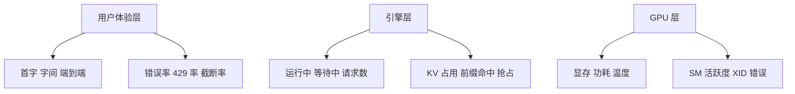

## Q
**深挖：指标清单与基数控制**｜完整答案 · LLM 服务的可观测性与成本

面试官：「列出你的核心指标，分到用户体验、引擎、GPU 三层。有人提议给所有指标加上 `tenant` 和 `request_id` 标签，方便排查，你同意吗？」

## A
**一句话。** 三层各选少量关键指标，延迟全部用直方图；指标标签只放低基数的维度（模型、区域、副本、优先级），租户和请求 ID 这类高基数维度放进每请求一条的宽事件表里查。给指标加 `request_id` 会让时间序列数爆炸、把 Prometheus 拖垮。

**三层指标。**
- **用户体验：** `vllm:time_to_first_token_seconds`、`vllm:inter_token_latency_seconds`、`vllm:e2e_request_latency_seconds`（直方图，看 p50、p95、p99）；网关侧的错误率、429 比例；`finish_reason=length` 的截断比例。网关和引擎两边都要量，因为网关的数字包含排队和网络，才是用户感受到的。
- **引擎：** `vllm:num_requests_running`、`vllm:num_requests_waiting`、`vllm:kv_cache_usage_perc`、`vllm:request_queue_time_seconds`、前缀缓存命中（`vllm:prefix_cache_hits` ÷ `vllm:prefix_cache_queries`）、输入输出词元计数器（`vllm:prompt_tokens_total`、`vllm:generation_tokens_total`）。
- **GPU：** 用 DCGM 导出器采集显存占用、功耗、温度、XID 错误（GPU 硬件或驱动报的错误码），以及 SM 活跃度（流式多处理器真正在算的时间比例）。普通的"GPU 利用率"只表示"有没有计算在跑"，几乎没有区分度。

**基数怎么算。** 时间序列数 = 每个指标的标签值组合数。一个直方图约 15 个桶；500 个副本（每个副本只属于一个模型和区域）就是约 7,500 条序列，完全没问题。再加上 `tenant` 标签，每个副本最多可能见到 300 个租户，最坏约 225 万条，每个直方图指标都这样乘一遍，Prometheus 的内存和查询都会扛不住。`request_id` 每个请求一个新值，序列数无限增长。

**高基数的东西放哪：** 网关在每个请求结束时写一条宽事件：`request_id`、租户、模型、清单版本、区域、副本、输入输出词元数、缓存命中词元数、排队时间、TTFT、TPOT、`finish_reason`、状态码。写入 ClickHouse 这类列式库，按任意维度聚合和钻取，比如"租户 42 昨天 p95 首字延迟"。

**故障与处理。**
- **直方图分桶不合适：** 默认桶的上限太低，所有超过 10 秒的请求都落在最后一个桶里，p99 算不出来。按实际分布设桶，首字延迟覆盖 0.05–30 秒。
- **平均值误导：** 平均 TPOT 20 ms，但 p99 是 300 ms（长输入的预填充插进来时的卡顿）。看分位数，并单独看最大值。
- **只看引擎侧：** 引擎说首字 0.3 秒，用户却等了 3 秒，时间花在网关排队或跨区溢出。网关侧的端到端数字是唯一的真相。

**为什么这样，不那样。**
- **不把所有维度都放进指标：** 指标适合低基数、高频聚合；任意维度的钻取交给事件库。
- **不只靠日志 grep：** 文本日志不能高效地按维度聚合，宽事件是结构化的。
