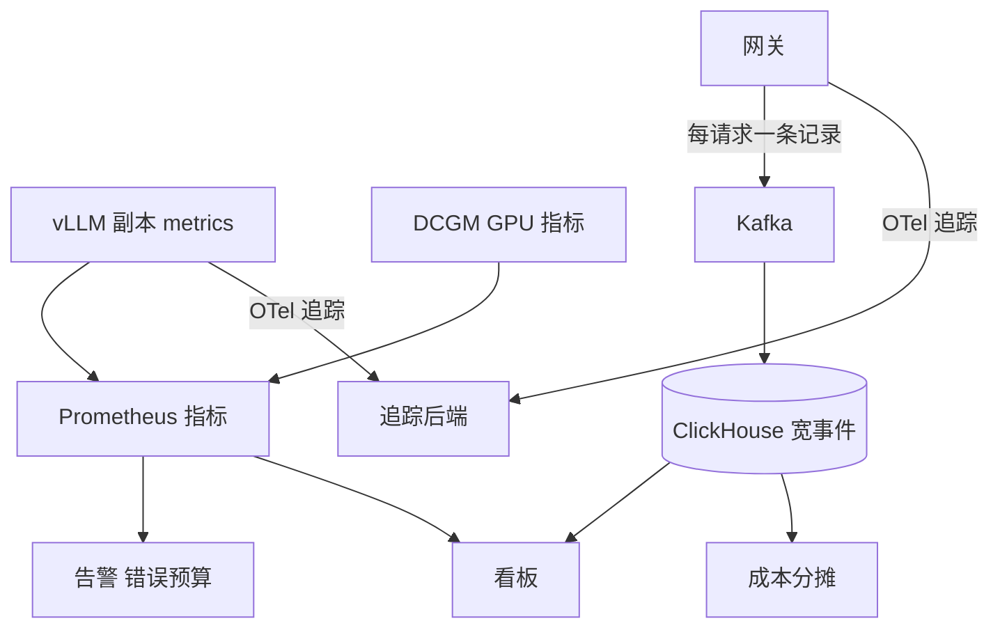

## Q
**全景**｜完整答案 · LLM 服务的可观测性与成本

面试官：「你负责一个多模型推理平台的可观测性。设计要采集什么、怎么采、怎么存、怎么告警，以及怎么算清每个模型、每个租户花了多少钱。」

## A
**一句话。** 三种信号各司其职：指标（Prometheus 直方图与计数器）回答"整体怎么样"，每请求一条结构化记录（宽事件）回答"哪些请求怎么样"，分布式追踪回答"某个请求的时间花在哪"；告警基于 SLO 的错误预算消耗速度；成本由"GPU 小时 × 单价"按词元用量分摊到模型和租户。

**几个词。** 首字延迟（TTFT）是从请求到第一个词元的时间；字间延迟（TPOT、ITL）是之后每个词元的间隔；KV 缓存占用是引擎为进行中的请求保存中间结果所用的显存比例；SLO 是延迟或可用性目标，错误预算是 SLO 允许的失败份额（99.9% 即 0.1%）。

**需求。**
- **看得见：** 每个模型、每个副本、每个租户的延迟分位数、吞吐、错误、排队与显存；任何一个慢请求能在 1 分钟内查到它的时间分解。
- **告得准：** 真影响用户才叫醒人；不影响的问题开工单。
- **算得清：** 每百万词元成本、每租户月度成本、GPU 利用率。
- **规模：** 2,000 请求/s、500 个副本、300 个租户。

**整体架构。**

**45 分钟路线。**

|时间|做什么|
|---|---|
|0–5 分|谁用这些数据：值班、容量、财务、客户|
|5–12 分|指标清单：用户体验、引擎内部、GPU、业务|
|12–20 分|架构：指标、宽事件、追踪三条管道|
|20–38 分|深挖：指标与基数、请求追踪、成本、告警|
|38–45 分|怎么验证这些数字本身是对的|

**必讲深挖。**
- **指标与基数：** 用户体验、引擎、GPU 三层指标；直方图分桶；租户这类高基数维度不放进指标标签。
- **请求追踪：** 网关 → 排队 → 预填充 → 解码的时间分解；按慢请求优先采样。
- **成本：** 每百万词元成本的公式与手算；按词元和占用时间分摊到租户；利用率的真实含义。
- **告警：** 多窗口错误预算消耗速度；什么叫醒人、什么开工单。

**级别期望。**
- **中级：** 知道 TTFT、TPOT、错误率，会配 Prometheus 和看板。
- **高级：** 三种信号分工、基数控制、按请求的时间分解、基于错误预算的告警、单位成本。
- **Staff：** 成本分摊与内部计费、容量与成本的长期趋势、可观测性系统自身的成本控制。
