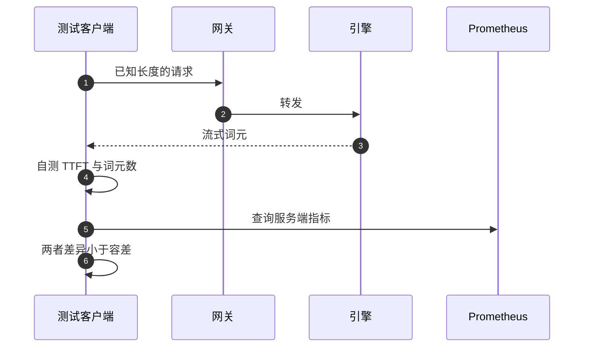

## Q
**测试可观测性本身**｜完整答案 · LLM 服务的可观测性与成本

面试官：「看板上的首字延迟、词元数和成本，你怎么知道它们是对的？告警规则你怎么知道它真的会响？」

## A
**一句话。** 用"结果已知"的合成流量校验数字：客户端自己测的延迟和词元数是真值，与服务端指标逐项对比；用故障注入校验告警：人为制造已知大小的坏请求比例，断言对应规则在预期时间内触发并送到正确的值班；看板和告警规则作为代码管理并跑单元测试。

**1. 指标数值校验。**
- **词元数：** 发 1,000 个输入长度已知（用同一分词器算好）、`max_tokens` 固定且不会提前停止的请求，断言 `vllm:prompt_tokens_total` 和 `vllm:generation_tokens_total` 的增量与预期一致，宽事件表和计费汇总的数字也一致。
- **延迟：** 客户端记录每个请求从发送到第一个 SSE 数据块的时间，与网关侧和引擎侧的首字延迟直方图对比。网关侧应接近客户端（差约一个网络往返）；引擎侧应更小，差值就是排队与网关开销。差异异常说明打点位置错了（比如在引擎收到请求后才开始计时，漏掉了排队）。
- **分位数：** 直方图算出的 p95 依赖分桶，与客户端精确计算的 p95 比较，偏差超过一个桶宽就要调整分桶。

**2. 告警校验（故障注入）。**
- **延迟注入：** 在预发环境用一个可配置延迟的模拟引擎，让 2% 的请求首字超过 1 秒（消耗速度 20 倍），断言"1 小时与 5 分钟"规则在约 5 分钟内触发，并送到正确的值班轮值。
- **恢复：** 停止注入，断言告警在短窗口回落后自动解除。
- **漏报场景：** 让某个区域停止上报指标，断言"监控失效"告警响起。

**3. 规则即代码。**
- **单元测试：** Prometheus 的 `promtool test rules` 可以用一段构造好的时间序列测试告警规则：给定这些输入，某时刻应该触发哪条告警。每次修改规则都在 CI 里跑。
- **评审：** 看板和告警的定义放在代码仓库里，修改要评审，避免有人在界面上手改导致无人知晓。

**4. 成本数字校验。** 每月把"分摊给所有租户的成本之和 + 平台自担部分"与云账单上的 GPU 费用对账，差异超过 2% 要查原因。

**为什么这样。** 可观测性是发布和扩缩容决策的输入；数字错了，所有基于它的自动化都会做错事，所以它和产品代码一样需要测试。
