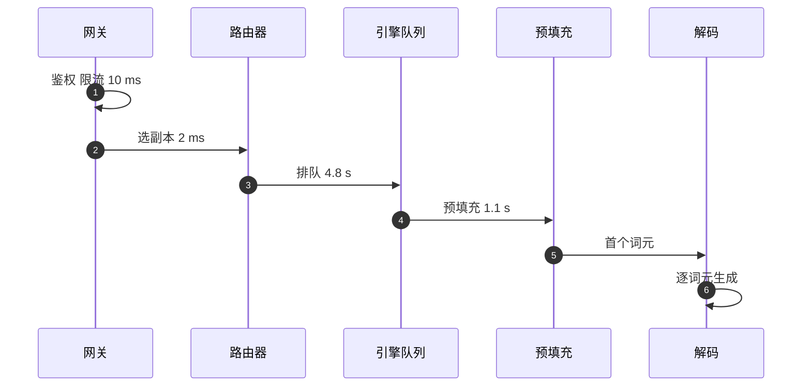

## Q
**深挖：单个请求的时间分解与追踪**｜完整答案 · LLM 服务的可观测性与成本

面试官：「一个客户投诉：某个请求的首字花了 6 秒。你怎么在几分钟内知道这 6 秒花在哪里？追踪数据量太大怎么采样？」

## A
**一句话。** 用 OpenTelemetry 在网关、路由器和引擎里打跨度（span），按 `request_id` 关联成一条追踪：鉴权与限流 → 路由选择 → 引擎排队 → 预填充 → 首个词元 → 解码；采样用"尾部采样"，即请求结束后再决定保留：慢的、出错的全部保留，正常的只留 1%。

**步骤。**
1. **传递上下文：** 网关生成 `request_id` 和追踪上下文，通过 W3C `traceparent` 头传给路由器和引擎；返回给客户端的响应头带 `x-request-id`，客户投诉时就能直接定位。
2. **打跨度：** 网关记鉴权、限流、路由；引擎记排队、预填充、解码。vLLM 可以用 `--otlp-traces-endpoint` 把请求级的追踪发到 OTLP 收集器。
3. **宽事件里也存分解：** 网关的每请求记录里写入排队时间、预填充时间、首字时间、解码时间，即使追踪没被采样，也能看到这一请求的大致分解。
4. **尾部采样：** OpenTelemetry Collector 的尾部采样处理器在追踪结束后判断：首字超过 2 秒、状态码不是 200、或者被抢占过的追踪全部保留，其他按 1% 保留。
5. **定位：** 本例分解显示排队 4.8 秒、预填充 1.1 秒。再查同一副本同一时刻：等待请求数 40、KV 占用 98%，说明这个副本过载；同时这个请求输入 3 万词元，预填充本身就慢。结论是路由把长请求派到了已过载的副本，改进点是路由打分考虑输入长度。

**故障与处理。**
- **跨度断开：** 某一层没有传递 `traceparent`，追踪断成两段。契约测试里断言每个下游请求都带着追踪头。
- **追踪本身拖慢服务：** 每个词元一个跨度会产生海量数据，也会占 CPU。只给阶段打跨度，不给每个词元打；导出是异步、批量的。
- **时钟不同步：** 跨机器的跨度时间对不上。各机器用 NTP 或 PTP 同步；阶段时长用同一台机器上的单调时钟测量。

**为什么这样，不那样。**
- **不用头部采样：** 请求开始时随机决定是否采样，慢请求只有 1% 被保留，正好丢掉最需要的。
- **不只看指标：** 指标告诉你 p95 变差了，但不告诉你是哪种请求、卡在哪一步。

**数字。** 2,000 请求/s，正常请求 1% 采样加上约 2% 的慢或错请求全保留，约 60 条追踪/s，每条几 KB，每天约 15–30 GB，可以接受。
