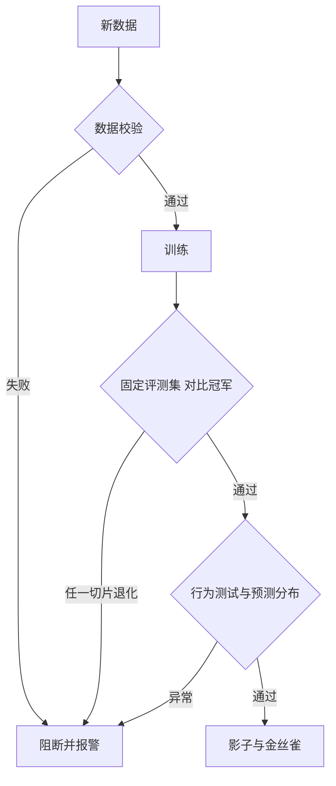

## Q
自动再训练流水线某天产出了一个更差的模型，并且自动上线了。可能是哪些原因？流水线里应该有哪些检查来阻止它？

## A
**常见原因：**
- **坏数据批次：** 上游某天把一个字段全部写成空值，再训练时模型学到"这个特征没用"，上线后效果下滑。
- **标签不成熟：** 用了最近 3 天的订单，拒付还没来得及发生，大量欺诈订单被当成正常样本。
- **数据泄漏：** 新加的一个特征其实是在结果发生之后才产生的（比如"是否已退款"），离线指标暴涨，线上根本拿不到这个值。
- **投毒或刷量：** 恶意用户集中点踩或刷好评，污染了大语言模型的反馈数据。
- **评测集也变了：** 用同一批新数据既训练又评测，或者评测集每次随机重抽，分数不可比。

**流水线里的检查：**

1. **训练前的数据校验：** 行数、空值比例、取值范围、标签比例和上一次训练相比不能变化太大；标签只用"已成熟"窗口的数据。
2. **固定评测集，对比冠军：** 用带版本、和训练数据不重叠的评测集；新模型在总体和每个重要切片上都不能比线上冠军差超过阈值，否则阻断。
3. **"好得可疑"也阻断：** 指标突然大幅提升（比如 AUC 从 0.85 到 0.98），首先怀疑数据泄漏，需要人工确认。
4. **行为测试：** 一组固定的用例（同义改写不该改变结果、明显的欺诈样本必须被拦），任一失败就阻断。
5. **预测分布检查：** 在同一批最近的数据上，新旧模型的拦截率、分数分布不能差太多。
6. **影子和金丝雀：** 自动再训练的模型同样走发布流程，不允许直接全量。

**原则：** 自动再训练可以自动**产出**候选模型，但上线必须经过和人工训练的模型一样的检查，失败时保持现有冠军不变。
