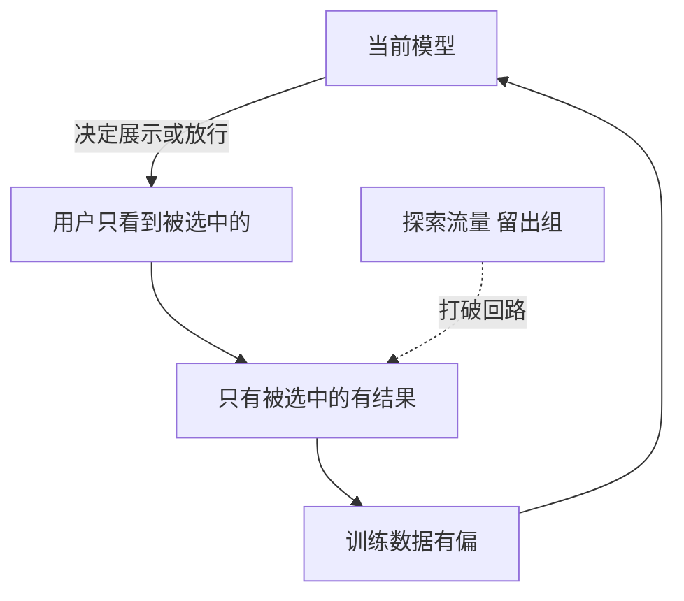

## Q
什么是反馈回路偏差（feedback loop bias），即"模型影响了自己的训练数据"？用推荐和欺诈各举一个例子，并说明怎样打破它。

## A
**问题的本质：** 你只能看到模型让你看到的结果。用这些结果再训练，模型会越来越确信自己原来的判断，即使原来的判断是错的。

**推荐的例子：**
- 模型给用户 A 推了 10 部动作片，他点了 2 部；没推爱情片，所以他也没机会点。
- 训练数据里：动作片有点击，爱情片没有任何记录。新模型学到"A 只喜欢动作片"，推得更多。
- 几轮之后推荐越来越窄，用户其实喜欢的东西一直没有被展示过，这叫"信息茧房"或"流行度偏差"：热门内容越推越热。

**欺诈的例子：**
- 模型把可疑订单直接拦截了，这些订单**永远不会有真实结果**（没发货，就不会有拒付）。
- 训练数据里只剩下"被放行的订单"的结果。如果模型错误地拦截了某类正常订单，你永远看不到它们其实是正常的，下一版模型会继续拦它们。

**打破的办法：**
- **探索（exploration）：** 留一小部分流量（比如 1%–5%）随机或按其他策略展示，让模型没选的内容也有机会产生结果。
- **留出组（holdout）：** 欺诈场景里随机放行一小部分本该被拦截的低额订单（在可承受的损失内），换取它们的真实标签，用来无偏地评估模型。
- **记录展示概率并加权：** 记下每个结果被展示的概率（propensity），训练时用它的倒数加权，校正"热门内容被展示得多"的偏差，这叫逆倾向加权（inverse propensity weighting）。
- **评估用随机流量：** 离线评估只在随机或探索流量的数据上做，否则评估结果也带同样的偏差。

**大语言模型的版本：** 用模型自己生成的回答（经用户点赞筛选）再微调，会放大它原有的风格和错误。微调数据要混入人工撰写或其他来源的数据，并保留不依赖当前模型的独立评测集。
