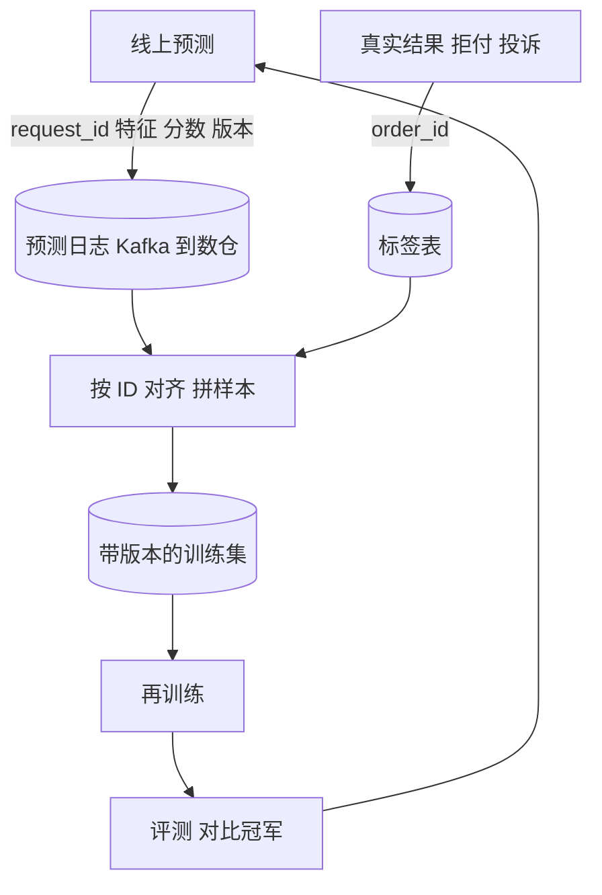

## Q
"反馈闭环"是怎样把线上数据变成下一版模型的训练数据的？以欺诈检测为例，说清每一步存什么、用什么键对齐。

## A
**一句话：** 线上每次预测都记下来，等真实结果到了，用同一个 ID 把"当时的输入和预测"与"后来的真实结果"拼成一条带标签的样本，攒够了就重新训练。

**每一步：**
1. **记预测日志：** 每次预测写一条（`request_id`、`order_id`、时间、**当时**的特征值、预测分数、模型版本、最终决策）。必须记当时的特征值，而不是事后再去查，因为事后特征已经变了（这叫"时点正确"，point-in-time correctness）。
2. **收标签：** 拒付通知、客服确认的欺诈、人工审核结果，各自带 `order_id` 写进标签表，并记下标签到达的时间。
3. **对齐：** 定时任务把预测日志和标签表按 `order_id` 连接。要等标签成熟：拒付可能在 60 天内陆续到达，太早拼会把"还没拒付"当成"正常"，造成假负例。
4. **成训练集：** 按时间切出带版本的数据集，比如"10 月 1 日到 10 月 31 日的订单，标签截止 12 月 30 日"。
5. **再训练和评测：** 新模型在最近一段时间的数据上和线上冠军对比，通过才进入发布流程。

**大语言模型的反馈：**
- **显式：** 点赞点踩、用户改写后的回答、人工标注员的偏好比较（两个回答选更好的一个）。
- **隐式：** 重新生成、复制回答、继续追问。
- **用途：** 很少直接重训底座模型，更多用于更新评测集、挑选微调数据、改进提示和检索库。
