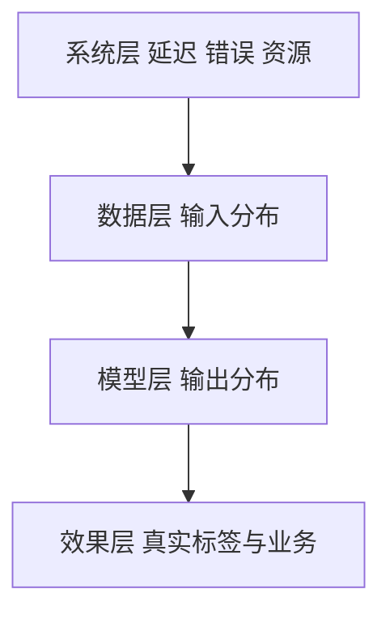

## Q
一个线上模型要监控哪些东西？为什么只监控延迟和错误率（普通服务的做法）不够？按层列出来。

## A
**为什么不够：** 普通服务坏了会报错；模型坏了通常**照常返回 200**，只是答案变差。比如上游把金额字段的单位从"元"改成"分"，欺诈模型照样每次返回一个分数，只是分数全错了。延迟和错误率完全正常。

**四层监控，从下往上：**

1. **系统层：** 延迟分位数（p50、p99）、错误率、吞吐、GPU 显存和利用率、副本数。和普通服务一样，坏了马上能发现。
2. **数据层（输入）：** 每个特征的空值比例、取值范围、均值和分布；类别特征出现了训练时没见过的新值的比例。大语言模型看输入长度分布、语言分布、主题分布。它能**提前**发现问题，因为输入变了，输出多半也会变。
3. **模型层（输出）：** 预测分数的分布、各类别被预测的比例。比如欺诈模型平时拦截 0.5% 的订单，今天变成 5%，一定有问题。大语言模型看输出长度、拒答率、被截断比例、安全分类器的违规比例。
4. **效果层（真实结果）：** 用真实标签算的准确率、召回率，以及点击率、转化率等业务指标。它最可靠，但往往**来得晚**：欺诈的真实结果（是否拒付）要几周后才知道。

**分工：** 第 1 层抓故障，第 2、3 层是早期预警，第 4 层是最终裁判。标签来得越晚，就越依赖第 2、3 层。

**每层都要按切片看：** 总体分布没变，但某个国家、某个 App 版本、某个渠道的输入可能已经全坏了。按关键维度分组监控，比只看总数早发现很多问题。
