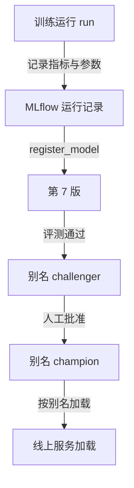

## Q
模型注册表（model registry）是什么？它存什么、和"把模型文件扔进 S3"有什么区别？用 MLflow 说明注册、打别名和按别名加载的过程。

## A
**一句话：** 模型注册表是模型的"版本库加档案室"。每训练出一个可能上线的模型，就登记一个**不可变的版本号**，同时记下它是怎么来的、表现如何、现在处于什么状态。

**它存什么：**
- **制品：** 权重文件（模型学到的参数）以及运行所需的配置、分词器等，通常实际放在对象存储里，注册表记位置和哈希。
- **血缘（lineage）：** 用的哪份训练数据（数据版本或快照 ID）、哪个代码提交、哪组超参数（训练前人为设定的值，如学习率）、哪次训练运行。
- **评估结果：** 在固定评测集上的指标，比如 AUC 0.91、某切片召回率 0.78。
- **状态与别名：** 哪个版本是线上冠军（champion）、哪个是挑战者（challenger）、谁在什么时候批准的。

**只扔进 S3 的问题：** 三个月后线上出问题，没人说得清线上那个 `model_final_v2_fix.pt` 用的是哪份数据、哪段代码；想回滚也不知道"上一个好版本"是哪个文件。

**MLflow 里的操作：**
- **注册：** `mlflow.register_model("runs:/<run_id>/model", "fraud-model")`，生成第 7 版。
- **打别名：** `MlflowClient().set_registered_model_alias("fraud-model", "champion", 7)`。旧的"Staging / Production 阶段"写法在 MLflow 2.9 以后已不推荐，改用别名和标签。
- **加载：** 服务用 `mlflow.pyfunc.load_model("models:/fraud-model@champion")`。上线新版本只是把别名指向第 8 版；回滚就是把别名指回第 7 版，模型文件本身从不修改。

**关键性质：** 版本不可变、别名可移动。这和 Git 的提交与分支指针是同一个思路。
