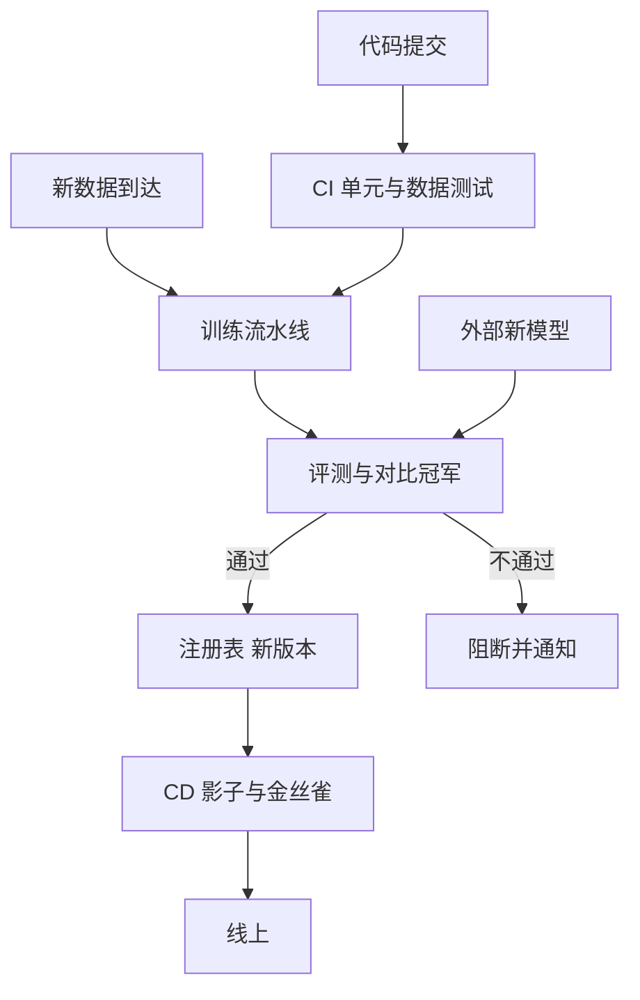

## Q
普通软件的 CI/CD 只在代码变化时触发。机器学习系统的 CI/CD 为什么要对"代码、数据、模型"三种变化都触发？流水线有哪些阶段？

## A
**为什么三种都要：** 机器学习系统的行为由三样东西共同决定：代码（特征处理、训练、服务）、数据（训练用的样本）、模型（训练出来的参数）。只改其中一样，线上行为就可能变：
- **代码变：** 改了一个特征的计算方式，旧模型拿到的输入就和训练时不同。
- **数据变：** 每周新数据进来，用同样的代码重新训练，模型也会变好或变坏。
- **模型变：** 换了一个新结构或新的开源大模型，代码和数据都没动。

**流水线阶段：**
1. **CI（持续集成）：** 代码的单元测试；数据校验（列是否齐全、取值范围、空值比例）；用一小份数据跑通整条训练，确保流水线本身没坏，几分钟内出结果。
2. **CT（持续训练，continuous training）：** 按计划（每周）或按触发（漂移报警、新标签积累到一定量）重新训练。
3. **评测：** 在固定、带版本的评测集上和当前线上模型（冠军）比较，总体和每个切片都不能退化超过阈值。
4. **注册：** 通过的模型登记为新版本，附上全部血缘和评测报告。
5. **CD（持续交付）：** 影子部署 → 金丝雀 → 全量，每一步按线上指标自动判断前进或回滚。

**成熟度的说法：** 常见的分级把"手工训练、手工上线"叫第 0 级，"训练流水线自动化、按数据触发再训练"叫第 1 级，"连流水线本身的代码变更也走 CI/CD"叫第 2 级。面试里能说清自己团队在哪一级、下一步补什么，比背定义有用。
