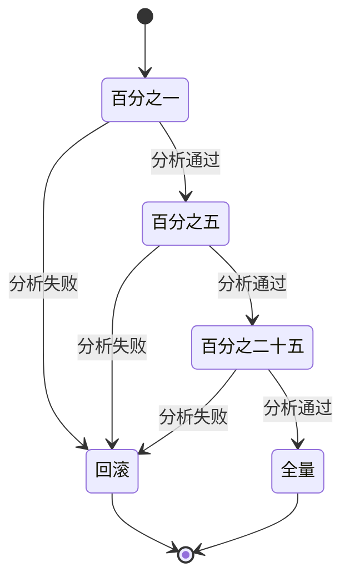

## Q
模型的金丝雀发布怎样做成自动的？流量按什么步子加、看哪些指标、谁来决定前进还是回滚？用 Argo Rollouts 或 KServe 说明。

## A
**步子：** 例如 1% → 5% → 25% → 50% → 100%，每一步停留足够长，让指标有足够样本。低流量服务每步要停更久，否则 1% 的流量里可能只有几十个请求，什么都看不出来。

**看的指标（新版本对比同时段的旧版本）：**
- **硬指标：** 错误率、p99 延迟、超时率、进程崩溃重启次数。
- **模型指标：** 预测分数的分布（比如欺诈分大于 0.9 的比例突然翻倍）、大语言模型的输出长度、拒答率、被截断比例。
- **业务代理指标：** 点击率、用户点"重新生成"的比例、差评率。

**Argo Rollouts 的写法：** `Rollout` 资源里的 `canary.steps` 列出 `setWeight: 5`、`pause: {duration: 30m}` 等步骤，并引用一个 `AnalysisTemplate`。模板里写 Prometheus 查询（比如新版本的错误率）和 `successCondition: result[0] < 0.01`，分析控制器按间隔执行查询；失败次数超过 `failureLimit` 就自动中止，流量回到旧版本。

**KServe 的写法：** `InferenceService` 的 predictor 里设 `canaryTrafficPercent: 10`，新的 `storageUri` 拿到 10% 流量；确认无误后删掉这个字段，全部流量切到新版本；回滚则把它设为 0。KServe 本身不做指标分析，常和外部的分析工具或发布流水线配合。

**谁决定：** 自动分析处理"明显坏"的情况，几分钟内回滚，不等人；"看起来没坏但是否更好"交给 A/B 实验和人来签发。

**大语言模型的特殊点：**
- **按用户粘住：** 同一会话的多轮对话必须一直用同一个版本，按用户或会话 ID 哈希分流，而不是按请求随机。
- **样本稀：** 质量问题（事实错误）在 1% 流量里很难统计显著，所以要先在影子阶段用评委模型把质量比完，金丝雀只负责抓工程和安全问题。
