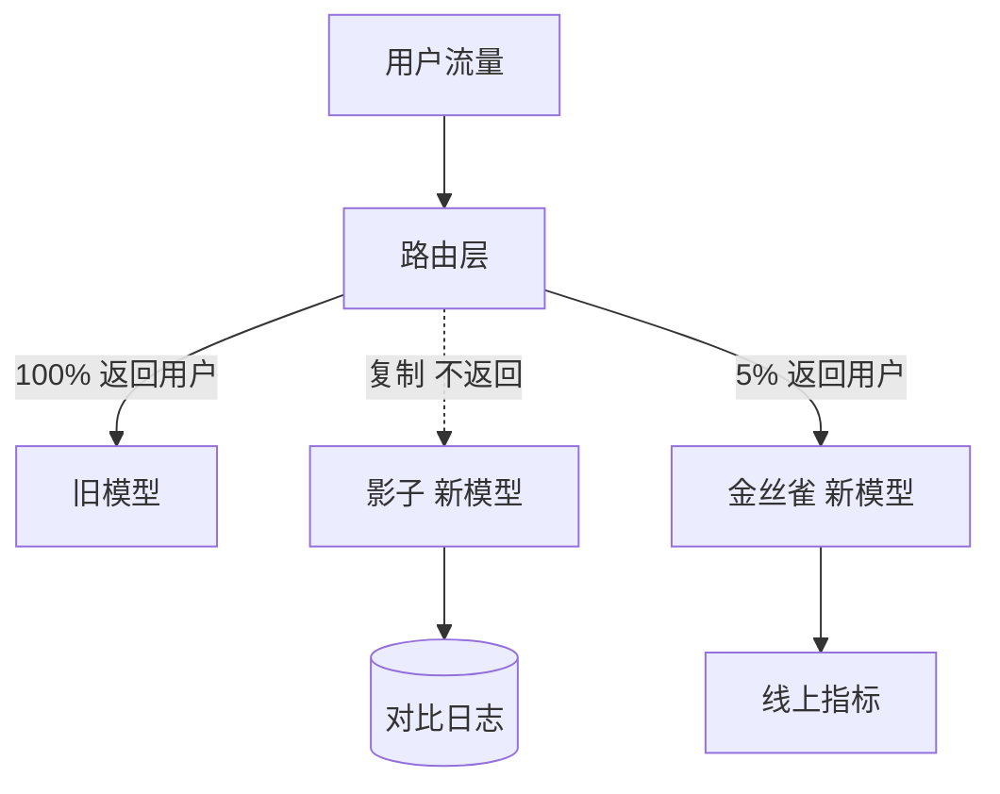

## Q
新模型上线有四种常见方式：影子部署、金丝雀、A/B 测试、蓝绿切换。它们各自回答什么问题？用户会不会看到新模型的输出？

## A
**一句话区分：**
- **影子部署（shadow）：** 复制一份真实流量给新模型，新模型的输出只记录、不返回给用户。回答"新模型在真实输入上会不会崩、慢不慢、输出和旧的差多少"。
- **金丝雀（canary）：** 先让 1%–5% 的真实流量由新模型服务，指标正常再逐步加大。回答"新模型对真实用户安全吗"，重点是**发现坏事**。
- **A/B 测试：** 把用户随机分成两组，各用一个模型，跑够样本量后用统计检验比较业务指标。回答"新模型是不是**更好**"。
- **蓝绿（blue-green）：** 新旧两套完整环境同时在线，一次性把全部流量从旧切到新，旧的保留随时切回。回答"怎样最快地切换和回滚"。

| 方式 | 用户受影响 | 能看业务效果 | 额外成本 | 典型时长 |
|---|---|---|---|---|
| 影子 | 否 | 否，用户没看到 | 新模型要按复制的流量备算力 | 几天 |
| 金丝雀 | 小部分 | 能看粗指标 | 少 | 几小时到几天 |
| A/B | 一半或按比例 | 能，有统计结论 | 少，但要等样本量 | 一到几周 |
| 蓝绿 | 全部，瞬间切 | 否 | 两套环境同时在线 | 切换几秒 |

**常见组合：** 影子（确认不崩、延迟达标）→ 金丝雀（确认对真实用户无害）→ A/B（确认真的更好，对业务影响大的模型才做）→ 全量。蓝绿常用于底层服务升级（比如推理引擎版本），因为它本身不比较效果，只追求切换和回滚快。
